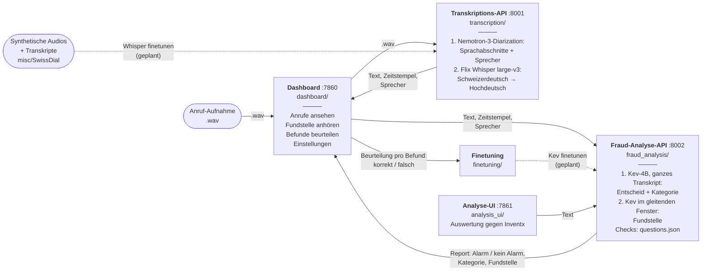

# Anruf-Prüfung (sprintd Zürich, Inventx-Case)

Bankanrufe auf Schweizerdeutsch automatisch transkribieren, auf Compliance-Verstösse prüfen und im Dashboard
beurteilen. Die Beurteilungen sind Labels für späteres Finetuning.

## Architektur



Gestrichelt: geplant. Die beiden APIs laden ihre Modelle erst bei Bedarf und geben die GPU danach wieder frei
(siehe Konfiguration). Die Analyse-UI ist ein Entwicklerwerkzeug und nicht Teil der App für Endnutzer.

| Ordner | Inhalt |
|---|---|
| `transcription/` | Nemotron-3-Diarization (Sprachabschnitte und Sprecher, Standard 2 via `MAX_SPEAKERS`), dann Flix-AI/flix-swissgerman-full pro Abschnitt (Schweizerdeutsch → Hochdeutsch). Dienst `api.py`, Batch `batch.py` |
| `fraud_analysis/` | Kev-4B (jaredpalmer/kev-4b): Entscheid über das ganze Transkript, gleitender Kev sucht für jeden Befund die Fundstelle. Checks in `questions.json`. Dienst `api.py` |
| `dashboard/` | Gradio-App für Endnutzer. Daten (SQLite, Audio) in `dashboard/data/` |
| `finetuning/` | Export der Beurteilungen als Trainingsdaten |
| `analysis_ui/` | Entwickler-Oberfläche und Auswertung gegen die Inventx-Sollbewertung |
| `misc/SwissDial/` | TTS für Schweizer Dialekte: Ausweichlösung, um synthetische Testaufnahmen zu erzeugen (nicht Teil der App) |

## Starten

```powershell
.\start.ps1             # Transkription, Fraud-Analyse, Dashboard -> http://localhost:7860
.\start.ps1 -Analyse    # zusätzlich die Entwickler-Oberfläche -> http://localhost:7861
```

Einzeln: `.venv\Scripts\python.exe -m transcription.api` (bzw. `fraud_analysis.api`, `dashboard.app`, `analysis_ui.app`).
API-Doku der Dienste: http://127.0.0.1:8001/docs und http://127.0.0.1:8002/docs.

## Konfiguration

- **Checks:** `fraud_analysis/questions.json`, zwei Listen (`gesetzlich`, `intern`). Wird bei jeder Analyse neu gelesen.
- **Alarm-Schwelle und Länge der Fundstelle:** im Dashboard unter „Einstellungen“.
- **GPU:** Kev braucht ~8 GB, die Transkription ~3.4 GB (Whisper + Nemotron, plus Arbeitsspeicher beim Rechnen). Beide Dienste laden ihr
  Modell erst bei der ersten Anfrage und entladen es nach `TRANSCRIPTION_IDLE_SECONDS` bzw. `FRAUD_IDLE_SECONDS`
  (Default 120 s) ohne Anfrage; `POST /unload` entlädt sofort. Das Dashboard transkribiert zuerst alle Dateien,
  entlädt dann das ASR-Modell und analysiert danach, sodass nie beide Modelle gleichzeitig auf der GPU liegen.
  `ASR_BATCH_SIZE` (Default 4) senkt den Bedarf der Transkription.

## Geplante Erweiterungen

Jeder Teil ist ein eigener Dienst bzw. Ordner und soll unabhängig wachsen:

| Erweiterung | Wo | Andockpunkt heute |
|---|---|---|
| ~~Sprechererkennung (Nemotron)~~ umgesetzt | `transcription/` | `segments[].speaker`. In den Inventx-Aufnahmen spricht eine einzige Stimme alles, dort gibt es daher nur „Sprecher 1“ |
| ~~Lokalisierung mit gleitendem Kev~~ umgesetzt | `fraud_analysis/` | `checks[].passage`: Kontextfenster ~40 Wörter, darin auf ~25 Wörter eingegrenzt; Länge im Dashboard unter „Einstellungen“, Fenster in `questions.json` → `localization` |
| Finetuning von Kev mit den Dashboard-Labels | `finetuning/` | `export_labels.py`: Ja/Nein pro Check und korrekt/falsch pro Fundstelle |
| Ablauf ohne Upload (Aufnahmen automatisch abholen) | neuer Dienst | heute stösst das Dashboard Transkription und Analyse an |
| Schweizerdeutsch → Schweizerdeutsch (ch→ch) | `transcription/` | zurückgestellt |

## Installation

Python 3.11, dann `pip install torch --index-url https://download.pytorch.org/whl/cu128` und
`pip install -r requirements.txt`. ffmpeg muss im PATH sein.
