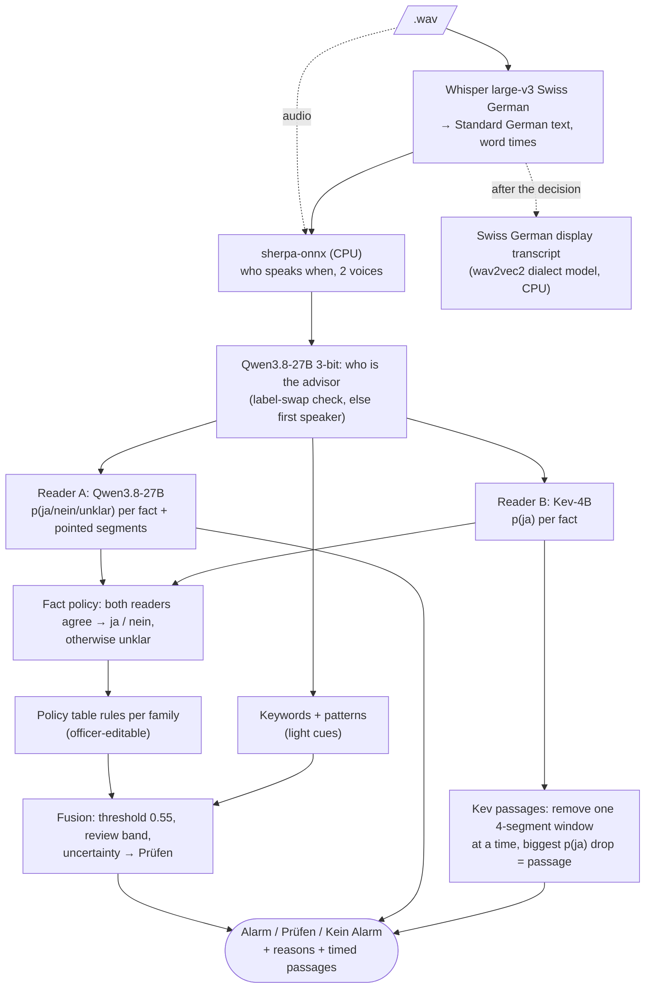

<p align="center"></p>

# Sherlock Phones

*Every bank call checked, not just samples.* (Package and CLI: `callguard`.)

Sherlock Phones checks Swiss German bank phone calls for compliance problems: insider trading, disclosing access codes,
disclosure to third parties, concealing documentation, and splitting payments to evade controls. For every call it
returns **Alarm / Prüfen / Kein Alarm**, the facts and the rule behind the decision, and timed audio passages, and it
says when it is unsure (Prüfen) instead of guessing. Everything is self-hosted; no cloud API.

- **Rebuild and run it:** [`GUIDE.md`](GUIDE.md) (written so a coding agent can follow it end to end).
- **What it achieved, measured from the `.wav` files only:** [`RESULTS.md`](RESULTS.md).
- **Case brief:** [`docs/CASE.md`](docs/CASE.md). Architecture: [`docs/ARCHITECTURE.md`](docs/ARCHITECTURE.md).
  HTTP API of the dashboard: [`docs/API.md`](docs/API.md). Operating concept: [`docs/OPERATING_CONCEPT.md`](docs/OPERATING_CONCEPT.md).

## How it works (production profile `sherlock`)



The models run one after another, so one 12 GB GPU is enough; with two GPU hosts the calls are split by audio length.
Details per step, models and settings: [`GUIDE.md`](GUIDE.md) §1.

## Honest limits

- **Rules were written with the case scripts in view.** The fact questions and rules (`config/policy_table.yaml`,
  `config/criteria.yaml`) were worded by the team while reading the organisers' labelled scripts (including dialogues we
  later held out). Every number on the 60 case calls is therefore in-sample for the rules. No script text is copied
  into the rules, and the pipeline reads only the audio at run time.
- **Settings chosen on the case calls:** the fact-policy band and the fusion threshold were chosen on the case dev calls.
- **Role fallback:** if the LLM's advisor answer fails the label-swap check or is unsure (confidence < 0.5), the first
  speaker is taken as the advisor, which matches every case call but may not hold for real calls.
- **Kev passages** show *where* a fact is said, not whether the fact is true; a fact said twice gives a small drop
  when one window is removed.
- The `oracle` / `demo-offline` profiles read reference scripts instead of audio; they exist for tests and UI work
  only and are never used for results.

## Licences

The code in this repository is not published under an open-source licence (all rights reserved by the team). The
models and tools it downloads keep their own licences:

| component | licence | note |
|---|---|---|
| ASR: `gcoli/whisper-large-v3-swiss-german-mit` | MIT | base `openai/whisper-large-v3`: Apache-2.0 |
| Reader A + roles: `unsloth/Qwen3.8-27B-GGUF` (UD-IQ3_XXS) | Apache-2.0 | base `Qwen/Qwen3.8-27B`: Apache-2.0 |
| Reader B: `jaredpalmer/kev-4b` on `Qwen/Qwen3.5-4B-Base` | Apache-2.0 | trained on datasets with non-commercial terms (Yelp reviews, AG News, Amazon reviews): legal review needed before production use. Its serving code is in `fraud_analysis/kev` of this repo |
| Diarization: pyannote segmentation-3.0 (sherpa-onnx export) | MIT | attribution |
| Diarization: WeSpeaker ResNet34 VoxCeleb | Apache-2.0 | VoxCeleb data CC BY 4.0: attribution |
| Swiss German display view: `scasutt/wav2vec2-large-xlsr-52_Swiss_German` | Apache-2.0 (card) | trained on SwissDial (research use); display only, never used in a decision; `NO_GSW=1` skips it |
| Tools: llama.cpp, faster-whisper / CTranslate2, sherpa-onnx | MIT / MIT / Apache-2.0 | |

## What else is in the tree

- `experiments/`, `research/evidence/`, the non-`sherlock` profiles in `config/` and `config/splits.yaml` are research
  harness files that the tests and some library code still load; none of them is on the run path of `sherlock`.
- `api_fixtures/` and `frontends/swiss/static/fixtures/` are sample API answers captured from an earlier run (older
  profile, original file names). The dashboard uses them only when built with `VITE_USE_FIXTURES=1` and then shows a
  «Sample data» banner. Result files contain absolute paths of our hosts (snippets, model folder); they do not matter.

## Configuration without code

Officers change the threshold, the fact policy (how strict both readers must agree), the rules and the keyword list in
the dashboard (`frontends/swiss`, served by `callguard api`). Rules and keywords live in `config/policy_table.yaml` and
`config/keywords.json`; versions of the rule book go to `config/policy_versions/`.

## Adding a plugin, caching, fusion details

### Adding a plugin (3 steps, no registry edit)

1. **Subclass** a base class from `callguard/plugins.py`: `ASRBackend.transcribe`, `Diarizer.diarize`,
   `Check.run`, `Fusion.decide`, `LLM.chat` (+ `choice_probs`), `Sink.emit`. The constructor is
   `__init__(self, ctx, <explicit keyword params>)`. Pass every param to `super().__init__`, so
   `cache_params()` (the cache key) sees them and a typo in the YAML raises.
2. **Put the file on the import path**: the repo root with `PYTHONPATH=.`, or anywhere under `src/`.
3. **Reference it** from a profile as `type: module:Class`. For a short name, add it to
   `registry.BUILTINS` or decorate the class with `@register("check", "pressure")`.

A complete check, `examples/pressure_check.py` (tested in `tests/test_core.py`), flags urgency and
secrecy phrases as weak evidence for chosen families:

```python
from __future__ import annotations

import re
from typing import TYPE_CHECKING

from callguard.plugins import Check
from callguard.types import CheckResult, Family, FamilyScore, Finding, Transcript

if TYPE_CHECKING:
    from callguard.context import Context

CUES = ["sofort", "dringend", "heute noch", "so schnell wie möglich", "niemandem sagen", "unter uns"]


class PressureCheck(Check):
    def __init__(self, ctx: Context, cues: list[str] | None = None, families: list[str] | None = None,
                 per_hit: float = 0.2, confidence: float = 0.3, *, name: str | None = None,
                 weight: float = 1.0, enabled: bool = True):
        super().__init__(ctx, name=name, weight=weight, enabled=enabled, cues=cues, families=families,
                         per_hit=per_hit, confidence=confidence)
        self.patterns = [re.compile(rf"\b{re.escape(c)}\b", re.I) for c in (cues or CUES)]
        self.families = families
        self.per_hit = per_hit
        self.confidence = confidence

    def run(self, transcript: Transcript, families: list[Family]) -> CheckResult:
        hits = [(seg, m.group(0)) for seg in transcript.segments for p in self.patterns
                if (m := p.search(seg.text))]
        result = CheckResult(check=self.name, type=self.plugin_type, meta={"hits": len(hits)})
        for fam in families:
            if not fam.can_alarm or (self.families and fam.id not in self.families):
                continue
            score = 1 - (1 - self.per_hit) ** len(hits)  # noisy-OR: more cues, more pressure
            result.family_scores[fam.id] = FamilyScore(
                score=round(score, 4), confidence=self.confidence,
                reason=f"{len(hits)} Druck-/Geheimhaltungssignal(e)" if hits else "Kein Druck erkennbar",
                segment_ids=[seg.id for seg, _ in hits])
            result.findings += [
                Finding(check=self.name, family=fam.id, score=self.per_hit, segment_ids=[seg.id],
                        start=seg.start, end=seg.end, reason=f"Druck: «{cue}»", detail={"cue": cue})
                for seg, cue in hits]
        return result
```

```yaml
# config/pressure.yaml
extends: local.yaml
checks:                     # lists are replaced: restate the checks you keep
  - {name: keywords, type: keywords, weight: 0.35, fuzzy: 90}
  - {name: patterns, type: patterns, weight: 0.2}
  - {name: llm_judge, type: llm_judge, max_transcript_chars: 16000, weight: 1.0}
  - {name: geval, type: geval, max_transcript_chars: 16000, weight: 1.0}
  - name: pressure
    type: examples.pressure_check:PressureCheck
    weight: 0.2
    families: [trade, splitting]
```

`PYTHONPATH=. uv run callguard run call.wav -c config/pressure.yaml`. The fusion picks the new check
up by name (weight from the YAML, slider in the UI), its findings become passages, and its results
are cached under `.cache/check/pressure`. To develop a check without audio, build a `Transcript`
and call `Pipeline(cfg).process_transcript(t)`. LLM-based checks get their model through
`self.ctx.llm("default")` and should key their cache on criteria + LLM, not on the keyword list (see
`checks/llm_judge.py:LLMCheck`).

### Caching

Each expensive stage is content-addressed (`src/callguard/cache.py`). A stage reruns only when its
own inputs change:

| namespace | key | reruns when |
|---|---|---|
| `.cache/asr` | audio file hash + `asr.cache_params()` | model, language, beam, VAD, prompt change (not thread count) |
| `.cache/diarize` | transcript + audio hash + `diarizer.cache_params()` (incl. the role LLM's model) | ASR output or diarizer/LLM settings change |
| `.cache/check/<name>` | transcript + `check.cache_key(families)` | rule checks: params or keyword list. LLM checks: params, LLM type+model, criteria, `PROMPT_VERSION` (keyword edits do not rerun them) |
| `.cache/geval_steps` | family criteria + LLM | G-Eval evaluation steps, generated once per family |

Fusion and snippets are never cached. Degraded results are not stored, so they are recomputed next
time instead of being served forever: ASR that fell back to plain decoding (`meta.degraded`),
diarization with `meta.diarization.error` (model missing, LLM down), and checks with failed families
(`meta.errors`) or a total failure.

To invalidate: `--no-cache` recomputes everything for one run (no reads, no writes). Delete
`.cache/<namespace>` to rerun one stage. Bump `PROMPT_VERSION` in `checks/prompts.py` (or a plugin
param) after changing a prompt.

### How the label is decided (`fusion: weighted`)

Production uses `fusion: two_readers` (`src/callguard/fusion/two_readers.py`): it first combines the two fact
readers under the fact policy into one facts result, then decides exactly as the weighted fusion below.

For each family, over the checks that scored it (check weight `w`, the check's own `confidence`):

```
effective weight  e = w * max(confidence, 0.05)
family score        = sum(e * score) / sum(e)
disagreement        = min(1, 2 * weighted std of the scores)
uncertainty         = 0.5 * disagreement + 0.5 * (1 - w-weighted mean confidence)
```

The call score is the highest family that may alarm (`can_alarm: false`, e.g. `numbers`, only
annotates). The rules are checked in this order:

1. score >= `threshold` (0.55) -> **alarm**, or **review** if uncertainty > `max_uncertainty` (0.35)
2. score in [`threshold - review_band`, `threshold`) (band 0.15) -> **review** ("knapp unter Schwelle")
3. a check with weight >= 0.5 says `undetermined` for a family scoring >= `min_score_for_review`
   (0.25) -> **review** ("offener Sachverhalt")
4. uncertainty > `max_uncertainty` and score >= `min_score_for_review` -> **review**
5. otherwise **no_alert**. If every check failed, the label is **review**, never a silent no_alert.

Every rule that fires writes a German sentence with its numbers into `decision.reasons`. Passages are
the findings of families scoring above min(threshold - band, min_score_for_review), merged when
closer than `merge_gap` (3 s). The families that drive the label come first, and at most
`max_passages` (5) are kept. A passage longer than `max_passage_seconds` (60) is cut to a window
around the strongest short evidence inside it (e.g. a keyword hit), with a note naming the full
cited span. Small LLMs sometimes cite minutes of a call. The UI sliders override threshold,
band, max uncertainty, per-check weights and families for the session only. `callguard eval`
suggests a threshold.

