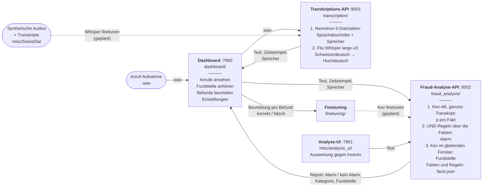

# Anruf-Prüfung (sprintd Zürich, Inventx-Case)

Bankanrufe auf Schweizerdeutsch automatisch transkribieren, auf Compliance-Verstösse prüfen und im Dashboard
beurteilen. Die Beurteilungen sind Labels für späteres Finetuning.

## Architektur



Gestrichelt: geplant. Die beiden APIs laden ihre Modelle erst bei Bedarf und geben die GPU danach wieder frei
(siehe Konfiguration). Die Analyse-UI ist ein Entwicklerwerkzeug und nicht Teil der App für Endnutzer.

| Ordner | Inhalt |
|---|---|
| `transcription/` | Nemotron-3-Diarization (Sprachabschnitte und Sprecher, Standard 2 via `MAX_SPEAKERS`), dann Flix-AI/flix-swissgerman-full pro Abschnitt (Schweizerdeutsch → Hochdeutsch). Dienst `api.py`, Batch `batch.py` |
| `fraud_analysis/` | Kev-4B (jaredpalmer/kev-4b) beantwortet über das ganze Transkript jeden Fakt; Regeln (UND über Fakten) entscheiden über den Alarm; gleitender Kev sucht für die Fakten ausgelöster Regeln die Fundstelle. Fakten und Regeln in `facts.json`, Auswertung in `rules.py`. Dienst `api.py` |
| `dashboard/` | Web-App für Endnutzer: FastAPI (`app.py`, JSON-API unter `/api`, Doku `/api/docs`) mit Oberfläche in `web/` (HTML/CSS/JS, ohne Build), Hintergrund-Prüfung in `worker.py`, Anzeige-Logik in `views.py`. Daten (SQLite, Audio) in `dashboard/data/` |
| `finetuning/` | Export der Beurteilungen als Trainingsdaten |
| `misc/analysis_ui/` | Entwickler-Oberfläche und Auswertung gegen die Inventx-Sollbewertung (nicht Teil der App) |
| `misc/SwissDial/` | TTS für Schweizer Dialekte: Ausweichlösung, um synthetische Testaufnahmen zu erzeugen (nicht Teil der App) |

## Starten

```powershell
.\start.ps1             # Windows: Transkription, Fraud-Analyse, Dashboard -> http://localhost:7860
.\start.ps1 -Analyse    # zusätzlich die Entwickler-Oberfläche -> http://localhost:7861
```

```bash
./start.sh              # Linux, macOS (und Git Bash unter Windows)
./start.sh --analyse
```

Beide rufen `start.py` auf: Es erkennt das Betriebssystem, nimmt das Python aus `.venv` und startet alle Teile im selben
Terminal (jede Zeile mit dem Namen des Teils davor). Ctrl+C beendet alle. Die Modelle laden erst bei der ersten Prüfung.

Einzeln: `.venv\Scripts\python.exe -m transcription.api` (bzw. `fraud_analysis.api`, `dashboard.app`, `misc.analysis_ui.app`).
API-Doku der Dienste: http://127.0.0.1:8001/docs und http://127.0.0.1:8002/docs.

## Konfiguration

- **Regeln und Fakten (hierarchische Prüfung):** Kev beantwortet zu jedem Anruf alle Fakten (Ja/Nein-Fragen). Ein Fakt
  ist ja, wenn sein Wert die Schwelle erreicht. Eine Regel verbindet Fakten mit UND (der erste ist die Grundfrage); löst
  mindestens eine Regel aus, gibt es einen Alarm. Im Dashboard unter „Regeln & Fakten“ ansehen, bearbeiten, hinzufügen,
  löschen. Gespeichert in `fraud_analysis/facts.json` über `PUT /config` der Fraud-Analyse; jede Änderung erhöht
  `version`, die vorherige Fassung liegt in `fraud_analysis/config_history/`. Die Werte pro Fakt werden pro Anruf
  gespeichert: Schwelle und Regeln über bestehende Fakten gelten sofort für alle Anrufe; neue oder geänderte Fragen
  brauchen „Neu prüfen“ beim Anruf.
- **Schwelle (für alle Fakten) und Länge der Fundstelle:** im Dashboard unter „Einstellungen“.
- **GPU:** Kev braucht ~8 GB, die Transkription ~3.4 GB (Whisper + Nemotron, plus Arbeitsspeicher beim Rechnen). Beide Dienste laden ihr
  Modell erst bei der ersten Anfrage und entladen es nach `TRANSCRIPTION_IDLE_SECONDS` bzw. `FRAUD_IDLE_SECONDS`
  (Default 120 s) ohne Anfrage; `POST /unload` entlädt sofort. Das Dashboard transkribiert zuerst alle Dateien,
  entlädt dann das ASR-Modell und analysiert danach, sodass nie beide Modelle gleichzeitig auf der GPU liegen.
  `ASR_BATCH_SIZE` (Default 4) senkt den Bedarf der Transkription.

## Geplante Erweiterungen

Jeder Teil ist ein eigener Dienst bzw. Ordner und soll unabhängig wachsen:

| Erweiterung | Wo | Andockpunkt heute |
|---|---|---|
| ~~Sprechererkennung (Nemotron)~~ umgesetzt | `transcription/` | `segments[].speaker`. In den Inventx-Aufnahmen spricht eine einzige Stimme alles, dort gibt es daher nur „Sprecher 1“ |
| ~~Lokalisierung mit gleitendem Kev~~ umgesetzt | `fraud_analysis/` | `facts[].passage`: Kontextfenster ~40 Wörter, darin auf ~25 Wörter eingegrenzt; Länge im Dashboard unter „Einstellungen“, Fenster in `facts.json` → `localization` |
| Finetuning von Kev mit den Dashboard-Labels | `finetuning/` | `export_labels.py`: Ja/Nein pro Fakt und stimmt/stimmt nicht pro Fundstelle |
| Ablauf ohne Upload (Aufnahmen automatisch abholen) | neuer Dienst | heute stösst das Dashboard Transkription und Analyse an |
| Schweizerdeutsch → Schweizerdeutsch (ch→ch) | `transcription/` | zurückgestellt |

## Installation

Python 3.11 und eine NVIDIA-GPU mit CUDA. ffmpeg muss im PATH sein.

```powershell
# Windows
py -3.11 -m venv .venv
.venv\Scripts\python.exe -m pip install torch --index-url https://download.pytorch.org/whl/cu128
.venv\Scripts\python.exe -m pip install -r requirements.txt
```

```bash
# Linux (ffmpeg z.B. mit: sudo apt install ffmpeg)
python3.11 -m venv .venv
.venv/bin/python -m pip install torch --index-url https://download.pytorch.org/whl/cu128
.venv/bin/python -m pip install -r requirements.txt
```

Die Modelle (Flix Whisper, Nemotron-3-Diarization, Kev-4B + Qwen3.5-4B-Base, zusammen ~14 GB) lädt der erste Start aus
Hugging Face in den lokalen Cache.
