# callguard architecture

This describes the plugin library as a whole. The production chain actually used (profile `sherlock`) is in
[`../README.md`](../README.md) and [`../GUIDE.md`](../GUIDE.md) §1; many plugins below exist but are not part of it.

Every Swiss German bank call -> transcript views -> several kinds of checks -> one explainable decision
(*alarm / review / no_alert*) with audio passages, timestamps and reasons -> the right desk. Operations and
security: [`OPERATING_CONCEPT.md`](OPERATING_CONCEPT.md).

## 1. Pipeline

```mermaid
flowchart LR
  A[Audio 16 kHz<br/>+ optional meta.json] --> ASR[ASR plugin<br/>faster-whisper Swiss German<br/>word timestamps]
  ASR --> DIA[Diarizer<br/>pyannote seg + WeSpeaker<br/>advisor / customer roles]
  DIA --> V1[view de<br/>Standard German]
  V1 -->|translator| V2[view en / gsw ...]
  ASR -.->|task=translate| V3[view en_speech]
  subgraph CHECKS["Checks (each reads one view, scores each family)"]
    K[keywords<br/>fuzzy, negation]
    P[patterns<br/>spoken digits, codes]
    KC[keyword_context<br/>G-Eval on keyword windows]
    SW[semantic_windows<br/>embeddings]
    J[llm_judge / quote_judge<br/>verified quotes]
    G[geval<br/>logprob-weighted]
    F[facts<br/>atomic questions + policy table]
    E[entities<br/>weight 0: who / which company]
  end
  V1 & V2 & V3 --> CHECKS
  CHECKS --> FU[Fusion<br/>weighted / calibrated / learned<br/>threshold + review band + uncertainty]
  FU --> D[Decision<br/>label, score, passages,<br/>reasons per passage]
  D --> SN[Snippets<br/>audio cut per passage]
  D --> SINKS
  subgraph SINKS["Sinks"]
    JS[json_dir<br/>result.json + provenance]
    NO[notify<br/>routing -> outbox / webhook / smtp]
    OU["outcept_trigger<br/>deep link ?call=..&t=.."]
    AU[audit<br/>decision events]
  end
  JS --> UI[Officer UI<br/>inbox, call detail, keywords,<br/>quality, notifications,<br/>feedback & tuning, patterns, audit]
  UI -->|feedback| FB[feedback.jsonl] -->|suggest + apply| TU[config/tuning.yaml overlay]
  TU -.->|load_config| FU
```

`Pipeline.process` (`src/callguard/pipeline.py`) runs the chain; every stage is a plugin chosen in YAML
(`config/<profile>.yaml`, `extends:` + `--set a.b=c`). One call never fails silently: a broken check is recorded
and the call is decided without it (visible in the UI), a call that cannot be processed counts as *review*.

## 2. Plugin kinds

| kind | built-in types | contract |
|---|---|---|
| asr | `faster_whisper`, `hf_whisper`, `remote` (GPU host over HTTP), `reference` (oracle only) | audio -> Transcript (segments, words, confidence) |
| diarizer | `sherpa_onnx`, `none` | speakers + advisor/customer roles |
| translator | `llm_translate`, `hf_mt`, `identity` | Transcript -> same segments in another language (view) |
| check | `keywords`, `patterns`, `keyword_context`, `anchored`, `semantic_windows`, `llm_judge`, `quote_judge`, `geval`, `facts`, `kev_facts` (Kev reader + masking passages), `entities`, `questions` (general yes/no set, max p(yes)) | Transcript + families -> per-family score, confidence, verdict, findings pinned to segments |
| fusion | `weighted`, `two_readers` (production: two fact readers under the fact policy, then weighted), `calibrated`, `learned` | all CheckResults -> Decision; pure and cheap (UI re-runs it on every slider move) |
| llm | `openai_compat` (vLLM, llama.cpp server, Ollama), `llama_cpp` in-process, `fake` (tests), `kev` (Kev-4B yes/no service), `pinned` (offline stand-in keyed like a cached model) | chat + JSON schema + next-token logprobs |
| sink | `json_dir`, `outcept_trigger`, `notify`, `audit` | finished CallResult -> somewhere; never breaks a call |

Adding one: subclass the base in `plugins.py` and reference it as `type: my_module:MyClass` (no registry
edit needed) or add it to `registry.BUILTINS`. CLI commands: `callguard/commands/<name>.py` with `register(app)`.
UI: a line in `ui/pages_registry.py` (pages) or `ui/panels/__init__.py` (call-detail panels).

**Families** (`config/keywords.json` + `config/criteria.yaml`, both editable in the UI) are the unit every check
scores: trade (insider), access (secrets), disclosure (third parties), documentation, splitting, numbers
(annotates, never alarms alone). The criteria (policy, alarm_when, not_alarm_when, review_when) are what the LLM
checks judge against, so an officer steers the language model in plain German, without prompts or code.

## 3. Transcript views

A call can be rendered several times: Swiss German fine-tuned ASR (Standard German text), dialect-text views,
LLM / MT translations, Whisper speech translation to English. Each check names the view it reads; fusion
merges findings by **audio time**, so a passage found on the English view still plays the right seconds and
shows what every view says there (`Passage.texts`). Without a `views:` block there is one view `main` and every
cache key equals v1's. `ref_*` views (reference scripts) exist only for oracle experiments, never in a submission.

## 4. Decision and explanation

Weighted fusion per family: weights x check confidence, contradiction between checks and low self-confidence
become **uncertainty**; call score = max over families that may alarm. `score >= threshold` -> alarm,
`[threshold - review_band, threshold)` -> review, and an alarm / no_alert near the line with uncertainty above
`max_uncertainty` is escalated to review. Each rule that fires writes a German sentence with its numbers into
`Decision.reasons`; passages carry the reasons of every check that cited them. The threshold is THE knob
(sidebar slider; saved per profile in `config/tuning.yaml`).

## 5. Caches and reproducibility

`cache.py` is content-addressed: ASR = hash(audio bytes, ASR params), diarization, translation and each check =
hash(input segments, plugin params, LLM identity, prompt version, relevant criteria). Changing one check reruns
only that check; moving the threshold reruns only fusion (milliseconds). Every result carries
`meta.provenance` (config hash, tuning overlay hash, code version, per-view and per-check parameters and model
ids); `runs/<profile>/audit.jsonl` records decisions, notifications, feedback and configuration saves.

## 6. Evaluation and experiment harness

- `config/splits.yaml`: dialogue-level folds (clean + noisy recording and Stufe2 twins always together) and a
  locked holdout, scored once per final candidate and logged (`runs/holdout_log.jsonl`).
- `callguard eval`: 3-class confusion, flag / alarm precision-recall-F1, false-alarm rate, miss rate, per level and
  noise, threshold sweep and out-of-fold threshold suggestion.
- `callguard experiment experiments/<x>.yaml`: variants (checks on/off, models, views, fusion knobs,
  re-fusion of stored results) on the dev folds with cross-validated thresholds, cost per call, paired
  bootstrap CIs and McNemar against a baseline; `callguard report` / `leaderboard` render tables and charts.
  With 30 dialogues small differences are noise; the reports say so.
- `callguard asr-eval`: WER/CER and keyword-spot recall per ASR model, independent of the checks.

## 7. Operations layer (stretch goals)

| module | what |
|---|---|
| `routing.py`, `config/routing.yaml`, `config/directory.yaml` | flagged call -> desks by family / label / cross-call pattern, supervisor cc, message with deep links, passages, reasons, snippet paths; `callguard route` |
| `sinks/notify.py` | delivery: outbox (`runs/<profile>/outbox.jsonl`, de-duplicated), webhook, SMTP |
| `checks/entities.py` | advisor / customer / companies from greetings, staff directory, optional LLM, recorder sidecar (wins) |
| `patterns.py` | per advisor / customer / company: calls, alarms, reviews, mean score; flags `repeat_advisor` (Wilson lower bound > population rate, min calls), `company_across_customers`, `repeat_family_customer`; `callguard patterns` |
| `feedback.py` | officer verdicts -> labels -> threshold sweep on stored results -> suggested threshold with expected FP/FN change, keyword precision, check reliability; `apply` writes the tuning overlay; `callguard feedback add/list/suggest/apply` |
| `audit.py` | append-only event log + `audit` sink; `audit.log_event()` for every save in the UI |

## 8. Where each jury criterion is addressed (in the hand-in)

| criterion (weight) | where |
|---|---|
| Creativity & innovation (20) | small yes/no **facts** answered by two different AI readers (a 27B chat model and the yes/no model Kev-4B), combined by an officer-set policy, then readable **rules** decide; Kev finds the passage by masking windows of the call |
| Feasibility (10) | self-hosted open models only, one 12 GB GPU per host (models loaded one after another), measured ~1 min per call on two GPUs (`RESULTS.md`), one command per folder of calls (`scripts/run_testset.sh`) |
| Design & usability (25) | dashboard `frontends/swiss`: call list with threshold, call page with player, transcript, passages with reasons, both readers' facts; rules, facts, keywords editable without code; demo: empty rule book -> one rule -> full rule book |
| Impact & relevance (20) | every call checked, both sides of the line (advisor and customer), decisions explained by facts and the rule that fired; unsure calls go to «Prüfen» instead of guessing |
| Detection quality & traceability (25) | `RESULTS.md`: all 60 case calls from audio alone, 0 false alarms, misses listed per call; every hit has passage + timestamp + reason + rule; a failed reader escalates to «Prüfen» (fail closed) |
