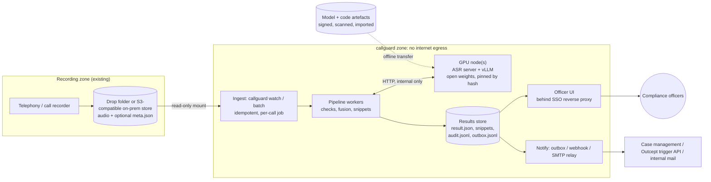

# callguard: operating concept for a bank's secured environment

For the jury (feasibility) and for bank architects. What runs where, what data goes where, who may do what,
how a decision is reproduced a year later, and what hardware it takes. Technical structure:
[`ARCHITECTURE.md`](ARCHITECTURE.md). "Built" = in the prototype today; "target" = the production step.

## 1. Principles

1. **Everything on-prem, nothing leaves the bank.** Speech recognition, language models, embeddings: open
   weights on the bank's own GPUs. No cloud API in the processing path (the prototype enforces this by
   design: every model is a plugin pointing at a local file or a local inference server).
2. **Decision support, not automated sanction.** The system sorts every call into *alarm / review /
   no_alert* with passages, timestamps and reasons. A compliance officer decides; the system never
   contacts a customer, blocks an order or rates an employee on its own.
3. **Every alert is explainable and reproducible**: which passage, which criterion, which checks, which
   models, which configuration (hashes), which threshold.
4. **Uncertain = human.** Contradicting or unsure checks escalate to *review*; a failed component makes the
   call *review*, never silently *no_alert*.

## 2. Deployment

- **Air-gapped GPU node(s).** One node runs the ASR server (`python -m callguard.serve.asr_server`, faster-whisper / CTranslate2, bearer token)
  and an OpenAI-compatible LLM server (vLLM or llama.cpp). Pipeline workers reach them over the internal network
  only (the prototype's `remote` profile does exactly this, today over Tailscale between two machines).
  Model weights and Python wheels enter through the bank's software import process (malware scan, hash check);
  the node has no route to the internet.
- **Ingest** reads the recorder's export read-only. `callguard watch` processes new files; results are written
  write-then-rename, so the UI never sees half a result. Reprocessing is idempotent (content-addressed caches).
- **Metadata sidecar** (`<audio>.meta.json`: advisor_id, customer_id, started_at, line): in production the
  recorder knows who was on the line; the prototype then trusts it over name recognition from the greeting.
  It is used for routing and cross-call patterns only, never as input to the decision.
- **Officer UI** (Streamlit) sits behind the bank's reverse proxy with SSO; the proxy passes the user identity
  (`CALLGUARD_USER`), which every audit event records.
- **Delivery**: the `notify` sink routes flagged calls (`config/routing.yaml`: family -> desk, review ->
  compliance desk, repeat-advisor pattern -> cc supervisor) to an outbox file (built), a webhook into case
  management (built), or the internal SMTP relay (built, untested against a real relay). The Outcept trigger
  API sink posts a deep link (`?call=<id>&t=<s>`) straight to the passage (built).

## 3. Data flow, classification, retention

| artefact | content | classification | where | retention (proposal, aligned with the recording policy) |
|---|---|---|---|---|
| audio | full call | client-identifying data (banking secrecy) | recorder store, read-only mount | unchanged: the bank's existing recording retention |
| transcript views | text of the call (gsw/de/en) | client-identifying | cache + result.json | as audio; deleted with it |
| check results, decision | scores, reasons, passages | client-identifying (quotes) | result.json | alarm/review: case lifetime; no_alert: e.g. 90 days |
| snippets | short audio cuts of flagged passages | client-identifying | runs/<profile>/<call>/snippets | alarm/review only; with the case |
| audit.jsonl | who/what/when, labels, hashes | internal, integrity-critical | append-only store (WORM in production) | >= the longest case retention |
| feedback.jsonl, tuning.yaml | officer verdicts, threshold changes | internal | results store / config repo | as audit |

- Data minimisation: snippets are cut only for flagged passages; no_alert calls keep timestamps, no clips.
  Deleting a recording deletes its derived artefacts (all keyed by call id).
- Legal frame to confirm with the bank's legal / DPO: banking secrecy (Art. 47 BankG), Swiss data protection
  act (revDSG, incl. a data protection impact assessment for systematic employee-related analysis),
  FINMA requirements on operational risk and on outsourcing (on-prem avoids the outsourcing question entirely),
  and the works agreement on monitoring employee calls (relevant for the advisor patterns, see 5).

## 4. Access control

| role | may | may not |
|---|---|---|
| compliance officer | read flagged calls of their desk, listen to snippets, give feedback, adjust the threshold *for their view* | change the saved configuration alone |
| compliance lead | approve threshold / keyword / criteria changes (second pair of eyes), read audit | delete audit entries |
| supervisor | receive cc on alarms of their advisors (routing), read those calls | read other teams' calls, see advisor statistics |
| ML / platform ops | deploy models and code, run experiments on dev data | read production call content outside incidents |
| internal audit | read everything, incl. audit log and provenance | change anything |
| advisor | — | access the system |

Built: per-user audit trail, deep links per call. Target: role mapping from the SSO groups at the reverse proxy
and per-desk result filters in the UI (the routing table already defines the desks).

## 5. Four-eyes and human oversight

- **On alarms** (target workflow on top of the built feedback): officer A reviews the passage and records a verdict
  (`confirmed` / `false_alarm` / `should_review` ...; built: UI buttons + `callguard feedback add`, stored with
  user and timestamp). An alarm is escalated to a case only after officer B confirms (target: UI gate on a
  second `confirmed` by a different user; the data model already carries user per verdict).
- **On configuration**: threshold, review band, check weights are saved to a per-profile overlay
  (`config/tuning.yaml`) with the old/new file hash in the audit log (built). Keyword list and criteria edits are
  audit events too (`audit.log_event`, built). Target: these files live in a config repository; a change needs an
  approved merge by the compliance lead, deployment then picks up the new hash.
- **Advisor patterns** ("advisor stands out repeatedly") use a conservative statistic (Wilson 95% lower bound of
  the flag rate above the population rate, minimum number of calls) and go to compliance, cc supervisor only by
  rule. They are a hint for a human, never a rating; usage must be covered by the works agreement.

## 6. Audit and reproducibility

- **Provenance in every result** (`result.json` -> `meta.provenance`, built): created_at, profile, config hash,
  tuning overlay hash + applied values, code version (git commit, `+dirty` flag), per view the ASR / translator
  parameters, per check its type, weight, parameters and LLM identity, fusion parameters.
- **Content-addressed caches**: transcripts and check results are keyed by the hash of their inputs (audio file
  hash, model + parameters, prompt version, criteria). Re-running an old call with the same hashes yields the
  same result from cache; a changed model or prompt invalidates exactly what it affects.
- **Append-only audit log** (`runs/<profile>/audit.jsonl`, built): `decision` (label, score, threshold, config and
  tuning hash), `notification` (to whom, which channel), `feedback`, `tuning_save`, `keywords_save` /
  `criteria_save`. Production: ship to the bank's WORM / SIEM.
- UI: detail panel "Herkunft & Audit" shows provenance and the audit trail of the call; page "Audit-Log" shows all.

## 7. Model governance

- **Inventory**: every model is a plugin config entry (ASR model path, LLM id, embedding model) that ends up in
  provenance. Licences are checked before use: e.g. the Swiss German large-v3 fine-tune `gcoli` is MIT, Qwen
  models Apache-2.0; fine-tunes derived from CC BY-NC data are excluded for a bank deployment
  (`docs/research/dialect_asr.md`).
- **Change process**: a new model, prompt or check is first an experiment variant (`callguard experiment`):
  dev folds only, paired bootstrap confidence intervals against the current champion, cost per call. The locked
  holdout is scored once per release candidate and every holdout run is logged (`runs/holdout_log.jsonl`).
  Then shadow mode (runs next to production, no notifications) on live traffic, then sign-off by the compliance
  lead, then switch the profile.
- **Monitoring**: weekly flag rate, review share, failed-check share, feedback-derived false-alarm and miss
  counts (`callguard feedback suggest` gives the expected FP/FN change of a threshold move). A rising
  false-alarm verdict rate on one keyword surfaces as "consider disabling K05".

## 8. Sizing

Measured on one RTX 4070 (12 GB) with the case's 60 calls (4 h 40 min of audio, `research/journal.md`):

| stage | model | measured | per audio minute |
|---|---|---|---|
| ASR | Swiss German turbo, int8, beam 1, VAD | all 60 calls in ~3 min, RTF 0.015 | ~0.9 GPU-s |
| ASR | Swiss German large-v3 (MIT), fp16, beam 1 | RTF 0.041 | ~2.5 GPU-s |
| diarization | pyannote segmentation + WeSpeaker (CPU, ONNX) | runs on CPU | CPU only |

ASR is cheap: 2,000 calls/day at 5 min = 10,000 audio minutes/day need ~2.5 (turbo) to ~7 (large-v3)
GPU-hours on one 4070, so one mid-range GPU covers the transcription of a mid-sized bank's day. The language
model layer is the cost driver; it is filled in from the experiment cost data:

<!-- SIZING -->
| LLM setup (checks) | LLM calls / call | GPU-s / call | calls / GPU-day | GPUs for 2,000 calls/day | source |
|---|---|---|---|---|---|
| TBD (lead fills from `runs/experiments/*/meta.json` cost) | TBD | TBD | TBD | TBD | TBD |
| *preliminary: Qwen2.5-7B-AWQ, 4 checks, vLLM on 4070* | *~10* | *31.8 s check time per call at 6 in parallel; 48 calls in 10 min* | *~6,900 (24 h, wall clock)* | *1* | journal 01:43 |
<!-- /SIZING -->

Production shape: 2 GPU nodes (active/active, each ASR + LLM; one can carry the daily load alone), 1 CPU
application node (pipeline workers, UI, results store), backed-up storage for results and audit. Larger models
(14B for the judge) need a 24 GB GPU or a second card.

## 9. Resilience

- A failing sink (mail relay down, trigger API down) never loses the result; it is logged and retried by the
  next run (outbox de-duplicates).
- A failing check is recorded in the result and the call is decided without it, visibly ("Prüfung
  ausgefallen"); a call that cannot be processed at all is reported as *review*.
- Backlog: per-call jobs, so a GPU outage delays decisions but never skips calls; the watch folder resumes.

## 10. Rollout

1. **Shadow** (4-6 weeks): all calls processed, nothing notified; officers label a sample -> threshold from
   feedback (`callguard feedback suggest`), keyword precision review.
2. **Pilot desk**: notifications to one desk (market surveillance), four-eyes on, weekly metrics.
3. **Production**: all desks, change process of section 7, quarterly model review.
