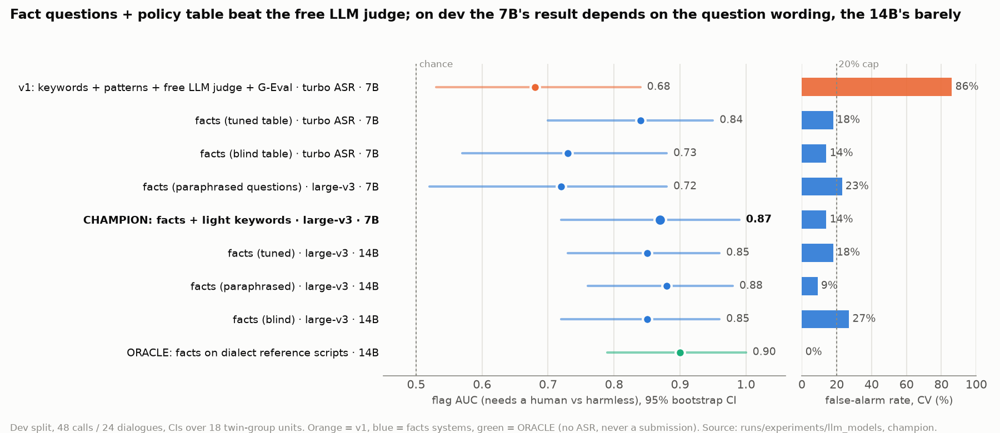

# Morning report — overnight research on the GPU host (2026-10-10)

_Last update: 05:55 (final). Read with `research/DEMO.md` (5-minute demo script), `docs/SUNDAY_RUNBOOK.md` (how to
process the hidden set) and `research/ideas_round3.md` (Q&A cheat sheet). Everything below is reproducible from
`experiments/*.yaml` + caches; numbers come from `runs/experiments/*/summary.md` and `research/journal.md`
(timestamped log of every run and decision)._

## TL;DR
1. **Recommended config for Sunday: `config/recommended.yaml`** (frozen 04:09)
   - ASR: `gcoli/whisper-large-v3-swiss-german-mit` (MIT licence), Standard German output.
   - LLM: Qwen2.5-7B-Instruct-AWQ on vLLM.
   - Decision: **`facts`**, which asks atomic yes/no/unknown questions (scored by log-probability) and decides with an
     officer-editable policy table (`config/policy_table.yaml`). Every alarm names the facts and the rule.
   - Keywords + patterns stay visible and editable with a light weight. No keyword hit means "abstain", not "harmless".
   - New calls on one 12 GB GPU: `scripts/run_staged.sh recommended` (ASR first, then the LLM). Verified end to end
     on 3 re-encoded audio files with neutral names (nothing cached): alarm / no alert / review all correct, ~90 s.
   - Single-pass fallback (live demo, UI "Anruf verarbeiten"): `config/recommended-turbo.yaml` (turbo ASR without
     prompt/conditioning fits next to the LLM): dev AUC 0.85, FAR 14%, miss 23%.
   - Officer UI: evidence timeline, "Warum kein Alarm?", review reasons, and the new **"Offene Fakten"** panel — the
     officer answers the open fact (e.g. "Code gültig? Ja/Nein") and the call is re-decided from the policy table, audited.
2. **Dev (48 calls, cross-validated):**
   - flag AUC **0.87 [0.72, 0.99]**, flag F1 0.86, false-alarm rate **14%**, miss rate 15%
   - alarm F1 0.86, review recall 67%, 3-class accuracy 79%
   - v1 (turbo ASR + free LLM judge + G-Eval): AUC 0.68, false alarms 86%, 3-class accuracy 38%.
   - Threshold-robust: flag decisions are identical anywhere from 0.45 to 0.65; 3-class labels from 0.55 to 0.65
     (at 0.45 the 10 "open fact" calls scored 0.50 turn from review into alarm).
3. **Holdout (champion run once; 12 calls / 6 dialogues; 3 logged looks in total — see Candidate B):**
   - champion: **0 false alarms** (6/6 harmless correct), the disclosure alarm D07 caught (both versions), alarm F1 0.67, 3-class accuracy 67%.
   - Missed: the splitting alarm C16 (one version only went to review) and the open documentation case C19.
   - v1 on the same 12 calls (one llm_judge check failed on one call: DEGRADED) sends *everything* to review: 100% false alarms, 3-class accuracy 17%.
   - n = 6 dialogues, so this is a sanity check, not a measurement.
4. **Why it works (evidence chain):**
   - check design >> model size: facts vs free judge +0.16 AUC (real); 7B vs 8B vs 14B ±0.1, not detectable.
   - better ASR helps once the checks are good: 7B facts 0.84 → 0.89 with large-v3 (CIs overlap, no paired test).
     Perfect transcripts (ORACLE) add only ~0.03.
   - the 7B reads Standard German ASR output at least as well as perfect dialect text (0.89 vs 0.76, CIs overlap).
5. **Honest caveats:**
   - The fact wording was written while reading dev transcripts.
   - Blind control: a table written from the criteria only scores 0.73-0.85 (equal to the tuned table on large-v3
     transcripts with the 14B).
   - Synthetic out-of-sample test (74 fresh twin scripts, mostly written by the judging 14B itself = circularity risk): facts keeps its large false-alarm advantage (14% vs 61%),
     but misses more (33%), mostly in access.
   - Open review cases (Stufe3) are the weakest spot everywhere.
   - Re-recorded audio (same dev calls, speed 0.96 + -3 dB -> different ASR output): AUC 0.83 vs 0.87, false alarms
     unchanged (14%), misses 15% -> 23% (4/48 labels change, no harmless call flips).
   - **Paraphrase test (R3): rewording the fact questions (same meaning) drops dev AUC 0.87 -> 0.72 (real, -0.15
     [-0.31, -0.03]) and flips 11/48 labels.** The tuned wording is fragile.
     A second independent paraphrase set repeats it (0.74). A paraphrase ensemble halves label flips under rewording
     (4-5 vs 8-11 of 48) but scores 0.73-0.81 on dev and is level with the tuned wording on synthetic calls (0.81 vs
     0.80) -> champion kept; expect ~0.75-0.80 AUC on new calls (estimate, not measured; v1: 0.68, with 86% false alarms).

## Candidate B (14B) — tested, not adopted
- Why tried: on large-v3 transcripts the 14B's facts decisions barely depend on the question wording (dev AUC tuned
  0.85 / blind 0.85 / paraphrased 0.88) while the 7B drops to 0.72 with paraphrased questions.
- Dev (`config/recommended-14b.yaml`): AUC 0.82, FAR 18%, miss 23%, 3-class 71%. Holdout (one logged run): FAR 33%,
  flag recall 33%, alarm F1 0.00, 3-class 33% vs the 7B champion's 0% / 50% / 0.67 / 67%.
- Decision: keep the 7B champion. Holdout looks in total: 3 (7B champion, v1 reference, 14B), all logged and listed in
  the journal — the holdout is spent. **Protocol note (research/AGENT.md): more than two looks make the holdout
  worthless as a final test** — we made two candidate looks + one reference look; treat all holdout numbers as
  sanity checks (n = 6 dialogues), not as the test-set result. The hidden set on Sunday is the real test.

## Where the champion is strong and weak (dev, per expected family, 48 calls)
| family | calls | flag correct | exact label | errors |
|---|---|---|---|---|
| trade (insider) | 14 | 14 | 14 | none |
| numbers (never alarms) | 6 | 6 | 6 | none |
| access (codes) | 10 | 8 | 8 | C09 alarm -> no_alert (code read out, validity unknown) x2 |
| disclosure (third party) | 8 | 6 | 5 | C11 harmless -> review x2, C12-K3 alarm -> review |
| documentation | 6 | 5 | 3 | C13 alarm -> review x2, C14-K3 harmless -> review |
| splitting | 4 | 2 | 2 | C20 open case -> no_alert x2 (table v3 fixes this on dev) |
Holdout misses (C16 splitting, C19 documentation review) fall in the same weak families.

## Leaderboard (dev, flag AUC; full table `research/leaderboard.md`)
| system | ASR | LLM | flag AUC [95% CI] | CV FAR | CV miss | 3-class acc |
|---|---|---|---|---|---|---|
| v1: kw + patterns + free judge + G-Eval | turbo | 7B | 0.68 [0.53, 0.84] | 86% | 15% | 38% |
| facts (tuned) | turbo | 7B | 0.84 [0.70, 0.95] | 18% | 27% | 73% |
| facts (tuned) | turbo | 14B | 0.87 [0.76, 0.96] | 14% | 23% | 75% |
| facts (blind table, R4) | large-v3 | 14B | 0.85 [0.72, 0.96] | 27% | 12% | 58% |
| **champion = facts + light kw/patterns** | **large-v3** | **7B** | **0.87 [0.72, 0.99]** | **14%** | **15%** | **79%** |
| facts ORACLE (dialect reference scripts) | none | 14B | 0.90 [0.79, 1.00] | 0% | 23% | 88% |

## What we tried tonight (and what it showed)
| area | tried | result | decision |
|---|---|---|---|
| bring-up | vLLM on driver 535 | newest vLLM needs CUDA 13 → vLLM 0.10.1.1; ASR runs at 1-2.5 GPU-s per audio minute | done |
| ASR (RQ2) | 8 models/settings, keyword-spot recall | large-v3 MIT 84%, Flix 76%, vanilla turbo ~76%, default turbo 71% | large-v3 MIT |
| ASR knobs (RQ8) | prompt, conditioning, beam, denoise, 3-way LLM repair | the keyword prompt leaked into a transcript; no-prompt/no-cond +10-12 pp noisy (turbo); denoise and repair: no gain | large-v3, knobs for turbo |
| checks (RQ4/5) | ablation, facts, quote judge, keyword-context, geval_cot, hybrid | facts wins; G-Eval stuck at 3/5 with 7B; hybrids add false alarms | facts core |
| LLM (RQ6) | Qwen2.5-7B, Qwen3-8B, Qwen2.5-14B (Qwen3-14B does not fit) | no detectable size effect | 7B (fits, fast) |
| views (RQ1/3) | de vs English translation vs dialect ORACLE | no gain from English; 7B not better on dialect text (CIs overlap) | Standard German |
| uncertainty (RQ9) | escalation, conformal/calibrated fusion (built), review modes | escalation sets a false-alarm floor; strict review mode trades 14% → 36% FAR for 83% review recall | simple fusion, optional strict mode |
| overfit checks | blind table, synthetic twins, paraphrases + ensemble (R3, R6) | gain partly dev-fitted, clearly not only | documented |
| design ablations | German vs English fact questions, roles hidden, prefix-max | English questions +0.13 AUC (real); roles help (borderline); prefix-max nothing | keep champion design |
| method | independent audit of the evidence code | stats correct; fixed ranking/holdout-logging/LLM-identity issues | fixed |

## Answers per research question
See `research/findings/RQ*.md`. Each has the setup, a CI table, flips, a recommendation and the strongest counter-argument.

## Still open (for the team on Saturday)
- Review side of facts (Stufe3) and the splitting family; table v3 with criteria-derived "open fact" questions was
  evaluated on dev + synthetic: team decision, see DECISIONS.md D2b (cannot be validated on the used holdout).
- Ask the organisers how `review` is scored. Flag F1 is meaningless here (flag-all = 0.70); we report AUC + FAR.
- Event GPUs: with ≥24 GB, Qwen2.5-14B (or larger) + large-v3 run side by side (`config/recommended-14b.yaml`): more
  robust to question wording on dev, but not better on dev or the holdout here (candidate B above).
- Tried and rejected after the freeze: S1 "confident clearance" rule (failed its pre-registered tests), paraphrase
  ensemble (R6), S2 fold-aware twin few-shot (fails 2 of 3 pre-registered rules: flips 11 -> 8, paraphrased AUC 0.70).

## How to use what is running
- vLLM (Qwen2.5-7B-AWQ) on :8000: `scripts/remote/swap_llm.sh <hf-id> [util] [max_len]`; stop: `kill $(cat runs/logs/vllm.pid)`.
- UI on the champion results: `uv run callguard ui -c recommended`. Experiment variants are selectable as a source.
- Sunday procedure (hidden set, scoring with labels, demo, fallback): `docs/SUNDAY_RUNBOOK.md`.
- Re-run anything: `uv run callguard experiment experiments/<name>.yaml --split dev` (cached), `callguard leaderboard`, `callguard report`.
