# callguard research report

Generated 2026-10-10 04:36 by `callguard report` from 9 experiment(s). Primary numbers are out-of-fold (CV) on the dev split; whiskers and brackets are 95% bootstrap CIs over dialogues (clean+noisy resampled together). With ~24 dev dialogues, differences inside the CIs are noise.

AUC is not decision-consistent: it ranks the fused call score, but review rules (uncertainty escalation, "undetermined" verdicts, review band) flag calls whatever the threshold, so for many variants no threshold reaches FAR <= 20% (see each variant's FAR floor). The top variants are ranked by cap compliance and CV@FAR20 recall, not by AUC.

## Top variants

| # | experiment / variant | split | n | CV@FAR20 R / F1 / FAR | cap | FAR floor | cap folds | flag AUC [95% CI] | alarm AUC | CV flag F1 [95% CI] | FAR | miss | bal. acc | review recall | alarm F1 | acc | check s/call | LLM calls/call | commit | tags |
|---|---|---|---|---|---|---|---|---|---|---|---|---|---|---|---|---|---|---|---|---|
| 1 | champion / **table_v3** | dev | 48 | 88% / 0.88 / 14% | ok | 14% | 4/4 | 0.92 [0.80, 1.00] | 0.90 | 0.91 [0.80, 1.00] | 14% | 8% | 0.89 | 100% | 0.86 | 83% | 4.9 | 10.0 | 3757224ef0* |  |
| 2 | champion / **facts_only** | dev | 48 | 85% / 0.86 / 14% | ok | 14% | 4/4 | 0.89 [0.77, 0.99] | 0.92 | 0.86 [0.73, 0.96] | 14% | 15% | 0.85 | 67% | 0.86 | 79% | 4.0 | 1.6 | 795bb55852* | re-fusion of champion |
| 3 | llm_models / **qwen25_7b_facts_l3** | dev | 48 | 85% / 0.86 / 14% | ok | 14% | 4/4 | 0.89 [0.77, 0.99] | 0.92 | 0.86 [0.73, 0.96] | 14% | 15% | 0.85 | 67% | 0.86 | 79% | 13.3 | 47.4 | 1fd19e75c0* |  |
| 4 | champion / **band025** | dev | 48 | 85% / 0.86 / 14% | ok | 14% | 4/4 | 0.87 [0.72, 0.99] | 0.90 | 0.86 [0.73, 0.96] | 14% | 15% | 0.85 | 67% | 0.86 | 79% | 4.1 | 1.6 | 795bb55852* | re-fusion of champion |
| 5 | champion / **champion** | dev | 48 | 81% / 0.84 / 14% | ok | 14% | 4/4 | 0.87 [0.72, 0.99] | 0.90 | 0.86 [0.73, 0.96] | 14% | 15% | 0.85 | 67% | 0.86 | 79% | 4.1 | 1.6 | 795bb55852* |  |
| 6 | champion / **t045** | dev | 48 | 81% / 0.84 / 14% | ok | 14% | 4/4 | 0.87 [0.72, 0.99] | 0.90 | 0.86 [0.73, 0.96] | 14% | 15% | 0.85 | 67% | 0.86 | 79% | 4.1 | 1.6 | 795bb55852* | re-fusion of champion |
| 7 | champion / **t065** | dev | 48 | 81% / 0.84 / 14% | ok | 14% | 4/4 | 0.87 [0.72, 0.99] | 0.90 | 0.86 [0.73, 0.96] | 14% | 15% | 0.85 | 67% | 0.86 | 79% | 4.1 | 1.6 | 795bb55852* | re-fusion of champion |
| 8 | champion / **noesc** | dev | 48 | 81% / 0.84 / 14% | ok | 14% | 4/4 | 0.87 [0.72, 0.99] | 0.90 | 0.86 [0.73, 0.96] | 14% | 15% | 0.85 | 67% | 0.86 | 79% | 4.1 | 1.6 | 795bb55852* | re-fusion of champion |
| 9 | llm_models / **qwen25_14b_facts_oracle** | dev | 48 | 77% / 0.87 / 0% | ok | 0% | 4/4 | 0.90 [0.79, 1.00] | 0.91 | 0.87 [0.70, 1.00] | 0% | 23% | 0.88 | 67% | 0.89 | 88% | 83.1 | 46.7 | 1fd19e75c0* | ORACLE |
| 10 | llm_models / **qwen25_14b_facts** | dev | 48 | 77% / 0.82 / 14% | ok | 14% | 4/4 | 0.87 [0.76, 0.96] | 0.91 | 0.82 [0.70, 0.92] | 14% | 23% | 0.82 | 0% | 0.79 | 75% | 79.1 | 46.7 | 5d9264d90c* |  |

`*` = uncommitted changes in the tree when the variant ran.

## asr_models

Detection quality per ASR model (Swiss German fine-tunes vs vanilla Whisper)

RQ: RQ2, RQ8 · split dev · baseline `turbo_gsw_int8` · details: `runs/experiments/asr_models/summary.md`

Floor on these calls: flag-all flag F1 0.70 (FAR 100%), flag-none 0.00, constant score AUC 0.50.

- `large_v3_gsw` vs `turbo_gsw_int8`: flag AUC -0.02 [-0.16, +0.11]; flag F1 +0.01 [-0.17, +0.18] (no detectable difference); FAR +41pp; McNemar p=0.5034; 28 calls flip

## champion

Recommended profile (large-v3 MIT + Qwen2.5-7B facts + light keywords/patterns) and its neighbours

RQ: RQ2, RQ4, RQ5, RQ9 · split dev · baseline `champion` · details: `runs/experiments/champion/summary.md`

Floor on these calls: flag-all flag F1 0.70 (FAR 100%), flag-none 0.00, constant score AUC 0.50.

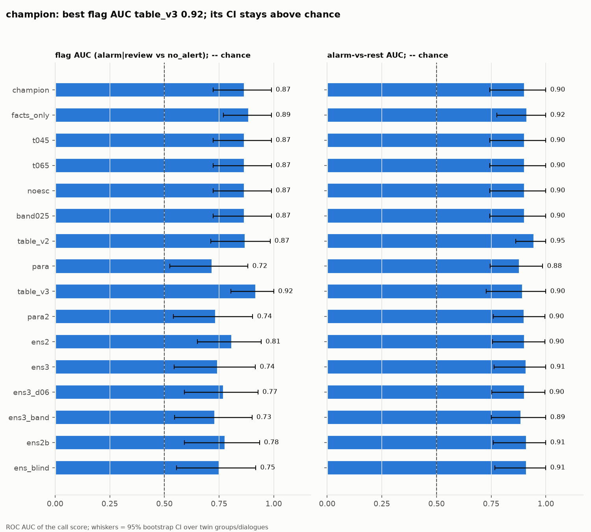

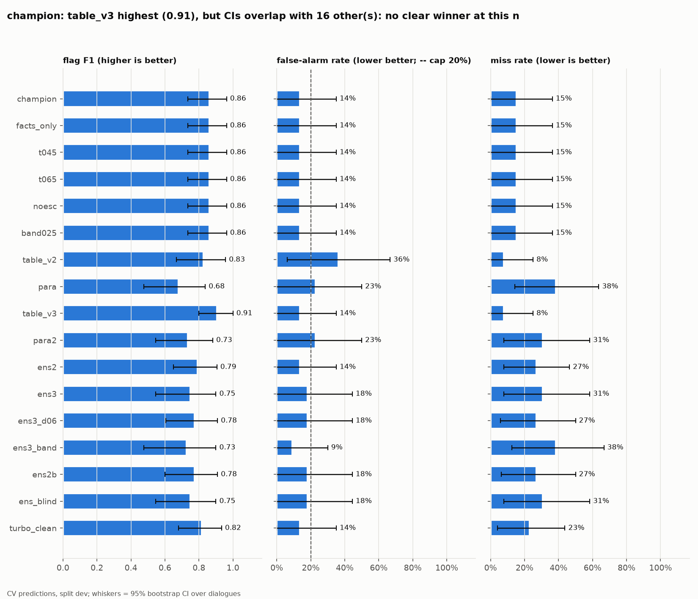

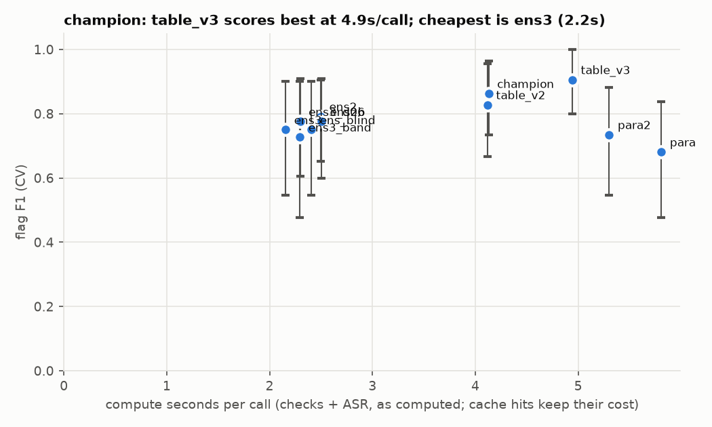

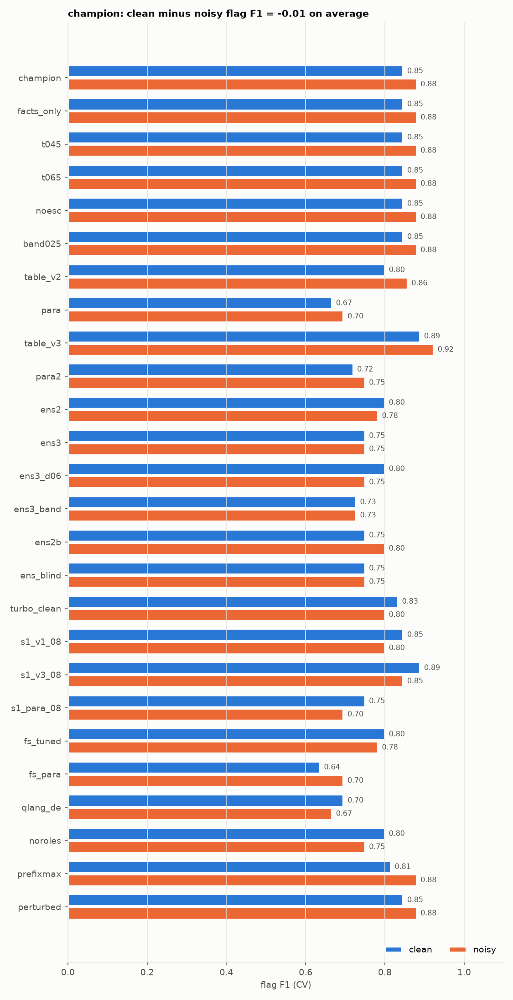

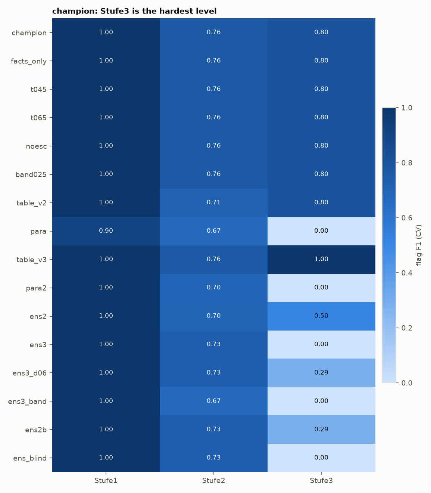

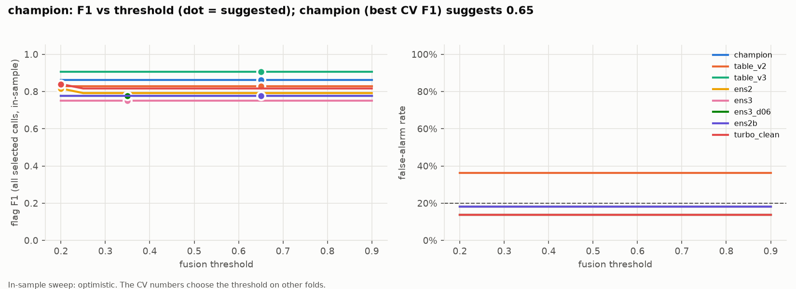

- `facts_only` vs `champion`: flag AUC +0.02 [+0.00, +0.06]; flag F1 +0.00 [+0.00, +0.00] (no detectable difference); FAR +0pp; McNemar p=1.0; 0 calls flip
- `t045` vs `champion`: flag AUC +0.00 [+0.00, +0.00]; flag F1 +0.00 [+0.00, +0.00] (no detectable difference); FAR +0pp; McNemar p=1.0; 0 calls flip
- `t065` vs `champion`: flag AUC +0.00 [+0.00, +0.00]; flag F1 +0.00 [+0.00, +0.00] (no detectable difference); FAR +0pp; McNemar p=1.0; 0 calls flip
- `noesc` vs `champion`: flag AUC +0.00 [+0.00, +0.00]; flag F1 +0.00 [+0.00, +0.00] (no detectable difference); FAR +0pp; McNemar p=1.0; 0 calls flip
- `band025` vs `champion`: flag AUC +0.00 [+0.00, +0.00]; flag F1 +0.00 [+0.00, +0.00] (no detectable difference); FAR +0pp; McNemar p=1.0; 0 calls flip
- `table_v2` vs `champion`: flag AUC +0.00 [-0.10, +0.12]; flag F1 -0.04 [-0.19, +0.08] (no detectable difference); FAR +23pp; McNemar p=0.4531; 9 calls flip
- `para` vs `champion`: flag AUC -0.15 [-0.31, -0.02] (real); flag F1 -0.18 [-0.36, -0.06] (**real difference**); FAR +9pp; McNemar p=0.0078; 15 calls flip
- `table_v3` vs `champion`: flag AUC +0.05 [+0.00, +0.17]; flag F1 +0.04 [+0.00, +0.14] (no detectable difference); FAR +0pp; McNemar p=0.5; 2 calls flip
- `para2` vs `champion`: flag AUC -0.13 [-0.29, -0.01] (real); flag F1 -0.13 [-0.29, -0.02] (**real difference**); FAR +9pp; McNemar p=0.0312; 13 calls flip
- `ens2` vs `champion`: flag AUC -0.06 [-0.14, +0.00]; flag F1 -0.07 [-0.15, +0.00] (no detectable difference); FAR +0pp; McNemar p=0.25; 12 calls flip
- `ens3` vs `champion`: flag AUC -0.12 [-0.28, -0.00] (real); flag F1 -0.11 [-0.28, +0.00] (no detectable difference); FAR +5pp; McNemar p=0.0625; 11 calls flip
- `ens3_d06` vs `champion`: flag AUC -0.10 [-0.23, -0.00] (real); flag F1 -0.09 [-0.21, +0.00] (no detectable difference); FAR +5pp; McNemar p=0.125; 11 calls flip
- `ens3_band` vs `champion`: flag AUC -0.13 [-0.29, -0.01] (real); flag F1 -0.14 [-0.34, +0.00] (no detectable difference); FAR -5pp; McNemar p=0.125; 12 calls flip
- `ens2b` vs `champion`: flag AUC -0.09 [-0.22, +0.00]; flag F1 -0.09 [-0.22, +0.00] (no detectable difference); FAR +5pp; McNemar p=0.125; 5 calls flip
- `ens_blind` vs `champion`: flag AUC -0.11 [-0.28, +0.00]; flag F1 -0.11 [-0.28, +0.00] (no detectable difference); FAR +5pp; McNemar p=0.0625; 12 calls flip

## checks_ablation

Which checks carry the decision (keywords, patterns, llm_judge, geval; add and remove)

RQ: RQ4 · split dev · baseline `all` · details: `runs/experiments/checks_ablation/summary.md`

Floor on these calls: flag-all flag F1 0.70 (FAR 100%), flag-none 0.00, constant score AUC 0.50.

- `keywords` vs `all`: flag AUC -0.14 [-0.34, +0.04]; flag F1 -0.20 [-0.47, +0.02] (no detectable difference); FAR -14pp; McNemar p=0.4049; 25 calls flip
- `kw_patterns` vs `all`: flag AUC -0.13 [-0.33, +0.04]; flag F1 -0.30 [-0.59, -0.04] (**real difference**); FAR -23pp; McNemar p=0.3075; 26 calls flip
- `kw_pat_judge` vs `all`: flag AUC -0.01 [-0.05, +0.04]; flag F1 +0.02 [-0.11, +0.16] (no detectable difference); FAR +45pp; McNemar p=0.4545; 19 calls flip
- `kw_pat_geval` vs `all`: flag AUC -0.12 [-0.29, +0.05]; flag F1 -0.30 [-0.55, -0.06] (**real difference**); FAR -41pp; McNemar p=0.6636; 23 calls flip
- `llm_only` vs `all`: flag AUC -0.02 [-0.09, +0.02]; flag F1 +0.03 [-0.06, +0.14] (no detectable difference); FAR +23pp; McNemar p=1.0; 17 calls flip
- `all_minus_keywords` vs `all`: flag AUC +0.01 [-0.00, +0.03]; flag F1 +0.02 [-0.10, +0.15] (no detectable difference); FAR +27pp; McNemar p=0.7744; 19 calls flip
- `all_minus_patterns` vs `all`: flag AUC -0.04 [-0.11, +0.01]; flag F1 -0.01 [-0.16, +0.13] (no detectable difference); FAR +23pp; McNemar p=0.5488; 11 calls flip
- `all_minus_llm_judge` vs `all`: flag AUC -0.12 [-0.29, +0.05]; flag F1 -0.30 [-0.55, -0.06] (**real difference**); FAR -41pp; McNemar p=0.6636; 23 calls flip
- `all_minus_geval` vs `all`: flag AUC -0.01 [-0.05, +0.04]; flag F1 +0.02 [-0.11, +0.16] (no detectable difference); FAR +45pp; McNemar p=0.4545; 19 calls flip

## fusion

Weighted-fusion knobs (N14 abstention, uncertainty source, review band, uncertainty cap) as re-fusions of one check run; fitted fusions via `callguard fusion-cv`

RQ: RQ9, RQ4 · split dev · baseline `base` · details: `runs/experiments/fusion/summary.md`

Floor on these calls: flag-all flag F1 0.70 (FAR 100%), flag-none 0.00, constant score AUC 0.50.

- `abstain` vs `base`: flag AUC -0.03 [-0.12, +0.04]; flag F1 +0.03 [-0.06, +0.14] (no detectable difference); FAR +23pp; McNemar p=1.0; 16 calls flip
- `abstain_llmunc` vs `base`: flag AUC -0.03 [-0.12, +0.04]; flag F1 +0.03 [-0.06, +0.14] (no detectable difference); FAR +23pp; McNemar p=1.0; 16 calls flip
- `llmunc` vs `base`: flag AUC +0.00 [+0.00, +0.00]; flag F1 +0.03 [-0.06, +0.14] (no detectable difference); FAR +23pp; McNemar p=1.0; 16 calls flip
- `band010` vs `base`: flag AUC +0.00 [+0.00, +0.00]; flag F1 +0.00 [+0.00, +0.00] (no detectable difference); FAR +0pp; McNemar p=1.0; 1 calls flip
- `band020` vs `base`: flag AUC +0.00 [+0.00, +0.00]; flag F1 +0.02 [-0.07, +0.14] (no detectable difference); FAR +27pp; McNemar p=0.7539; 11 calls flip
- `unc025` vs `base`: flag AUC +0.00 [+0.00, +0.00]; flag F1 +0.03 [-0.10, +0.18] (no detectable difference); FAR +50pp; McNemar p=0.4807; 23 calls flip
- `unc045` vs `base`: flag AUC +0.00 [+0.00, +0.00]; flag F1 +0.03 [-0.06, +0.14] (no detectable difference); FAR +23pp; McNemar p=1.0; 16 calls flip
- `noesc` vs `base`: flag AUC +0.00 [+0.00, +0.00]; flag F1 +0.03 [-0.06, +0.14] (no detectable difference); FAR +23pp; McNemar p=1.0; 16 calls flip
- `noesc_noband` vs `base`: flag AUC +0.00 [+0.00, +0.00]; flag F1 -0.01 [-0.16, +0.13] (no detectable difference); FAR +23pp; McNemar p=0.5488; 25 calls flip
- `abstain_noesc` vs `base`: flag AUC -0.03 [-0.12, +0.04]; flag F1 +0.03 [-0.06, +0.14] (no detectable difference); FAR +23pp; McNemar p=1.0; 16 calls flip

## holdout_v1

v1 baseline on the holdout (reference point for the champion's holdout run)

RQ: RQ4, RQ5 · split holdout · baseline `v1` · details: `runs/experiments/holdout_v1/summary.md`

Floor on these calls: flag-all flag F1 0.67 (FAR 100%), flag-none 0.00, constant score AUC 0.50.

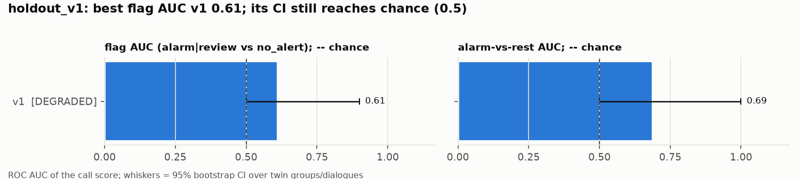

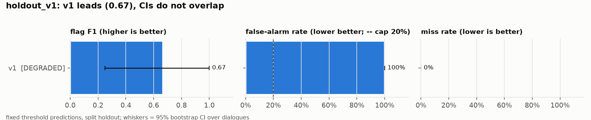

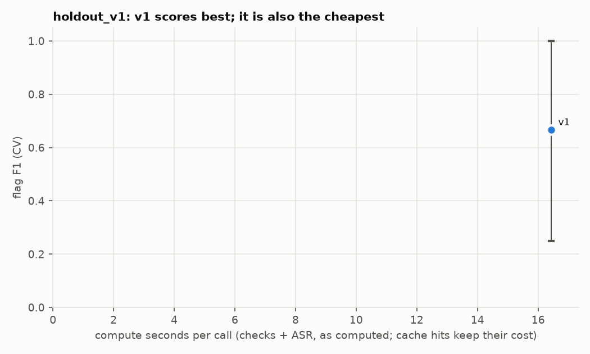

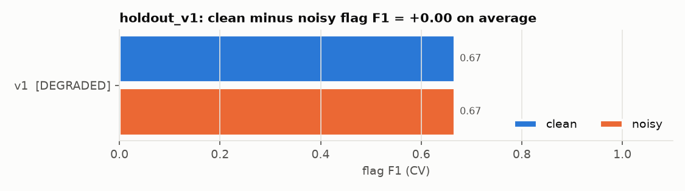

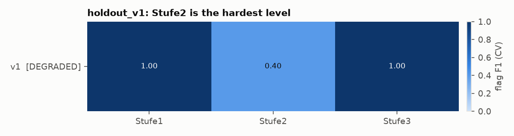

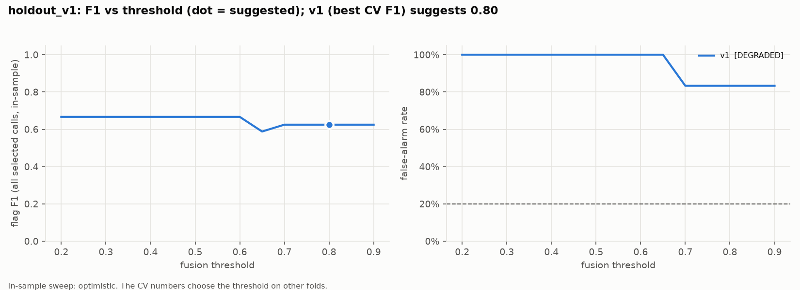

## llm_models

Check LLM sweep (Qwen2.5-7B-AWQ vs Qwen3-8B-AWQ vs Qwen2.5-14B-AWQ vs Qwen3-14B-AWQ)

RQ: RQ6 · split dev · baseline `qwen25_7b` · details: `runs/experiments/llm_models/summary.md`

Floor on these calls: flag-all flag F1 0.70 (FAR 100%), flag-none 0.00, constant score AUC 0.50.

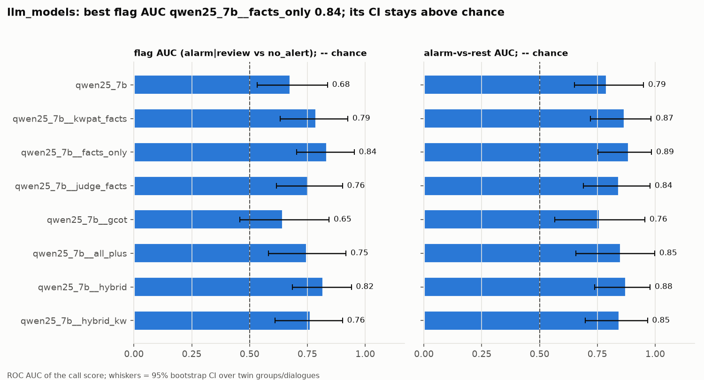

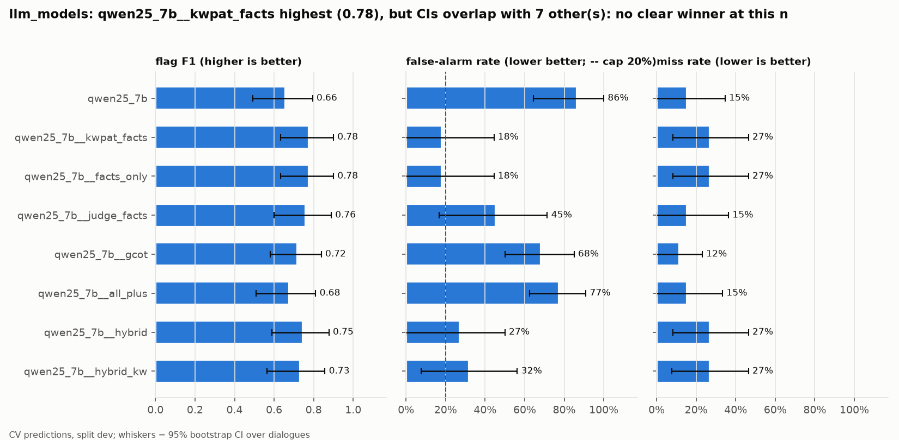

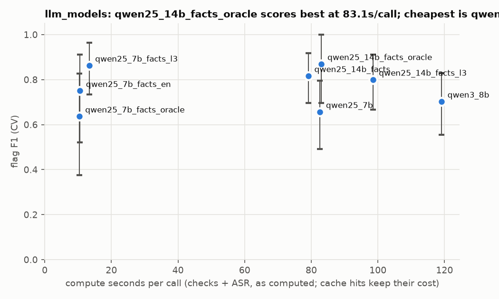

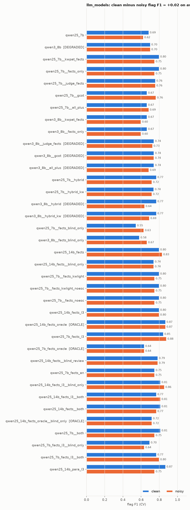

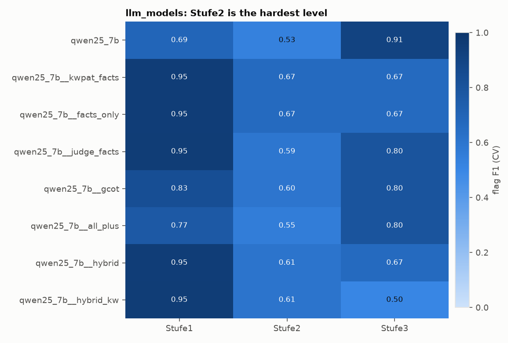

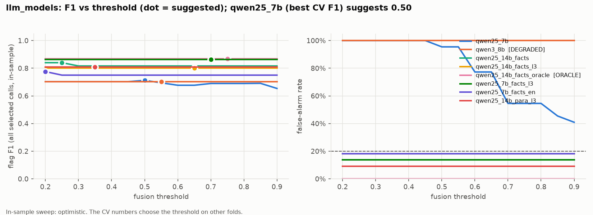

- `qwen3_8b` vs `qwen25_7b`: flag AUC -0.04 [-0.14, +0.05]; flag F1 +0.05 [-0.01, +0.12] (no detectable difference); FAR +14pp; McNemar p=1.0; 22 calls flip
- `qwen25_7b__kwpat_facts` vs `qwen25_7b`: flag AUC +0.11 [-0.01, +0.24]; flag F1 +0.12 [-0.04, +0.30] (no detectable difference); FAR -68pp; McNemar p=0.0169; 29 calls flip
- `qwen25_7b__facts_only` vs `qwen25_7b`: flag AUC +0.16 [+0.05, +0.28] (real); flag F1 +0.12 [-0.04, +0.30] (no detectable difference); FAR -68pp; McNemar p=0.0169; 29 calls flip
- `qwen25_7b__judge_facts` vs `qwen25_7b`: flag AUC +0.08 [+0.01, +0.17] (real); flag F1 +0.10 [-0.02, +0.24] (no detectable difference); FAR -41pp; McNemar p=0.0225; 25 calls flip
- `qwen25_7b__gcot` vs `qwen25_7b`: flag AUC -0.03 [-0.15, +0.07]; flag F1 +0.06 [-0.02, +0.17] (no detectable difference); FAR -18pp; McNemar p=0.2266; 25 calls flip
- `qwen25_7b__all_plus` vs `qwen25_7b`: flag AUC +0.07 [-0.04, +0.17]; flag F1 +0.02 [-0.07, +0.12] (no detectable difference); FAR -9pp; McNemar p=0.7539; 28 calls flip
- `qwen3_8b__kwpat_facts` vs `qwen25_7b`: flag AUC -0.01 [-0.17, +0.10]; flag F1 -0.02 [-0.29, +0.22] (no detectable difference); FAR -77pp; McNemar p=0.1849; 33 calls flip
- `qwen3_8b__facts_only` vs `qwen25_7b`: flag AUC +0.06 [-0.04, +0.15]; flag F1 -0.02 [-0.29, +0.22] (no detectable difference); FAR -77pp; McNemar p=0.1849; 33 calls flip
- `qwen3_8b__judge_facts` vs `qwen25_7b`: flag AUC +0.08 [-0.03, +0.17]; flag F1 +0.08 [+0.00, +0.19] (no detectable difference); FAR -9pp; McNemar p=0.0625; 21 calls flip
- `qwen3_8b__gcot` vs `qwen25_7b`: flag AUC -0.00 [-0.14, +0.10]; flag F1 +0.09 [+0.03, +0.18] (**real difference**); FAR -5pp; McNemar p=0.1797; 23 calls flip
- `qwen3_8b__all_plus` vs `qwen25_7b`: flag AUC +0.05 [-0.05, +0.13]; flag F1 +0.06 [+0.01, +0.13] (**real difference**); FAR +0pp; McNemar p=0.4531; 23 calls flip
- `qwen25_7b__hybrid` vs `qwen25_7b`: flag AUC +0.14 [+0.04, +0.26] (real); flag F1 +0.09 [-0.06, +0.24] (no detectable difference); FAR -59pp; McNemar p=0.0414; 28 calls flip
- `qwen25_7b__hybrid_kw` vs `qwen25_7b`: flag AUC +0.09 [-0.03, +0.21]; flag F1 +0.07 [-0.07, +0.22] (no detectable difference); FAR -55pp; McNemar p=0.0636; 31 calls flip
- `qwen3_8b__hybrid` vs `qwen25_7b`: flag AUC +0.08 [-0.06, +0.23]; flag F1 +0.05 [-0.10, +0.19] (no detectable difference); FAR -55pp; McNemar p=0.1516; 30 calls flip
- `qwen3_8b__hybrid_kw` vs `qwen25_7b`: flag AUC +0.03 [-0.15, +0.22]; flag F1 +0.07 [-0.07, +0.21] (no detectable difference); FAR -55pp; McNemar p=0.0931; 31 calls flip
- `qwen25_7b__facts_blind_only` vs `qwen25_7b`: flag AUC +0.06 [-0.06, +0.15]; flag F1 -0.07 [-0.32, +0.17] (no detectable difference); FAR -73pp; McNemar p=0.3616; 38 calls flip
- `qwen3_8b__facts_blind_only` vs `qwen25_7b`: flag AUC -0.01 [-0.13, +0.11]; flag F1 -0.03 [-0.29, +0.20] (no detectable difference); FAR -64pp; McNemar p=0.3269; 31 calls flip
- `qwen25_14b_facts` vs `qwen25_7b`: flag AUC +0.19 [+0.07, +0.31] (real); flag F1 +0.16 [+0.01, +0.33] (**real difference**); FAR -73pp; McNemar p=0.0043; 32 calls flip
- `qwen25_14b_facts__blind_only` vs `qwen25_7b`: flag AUC +0.10 [-0.04, +0.22]; flag F1 +0.08 [-0.07, +0.26] (no detectable difference); FAR -50pp; McNemar p=0.049; 37 calls flip
- `qwen25_7b__facts_kwlight` vs `qwen25_7b`: flag AUC +0.13 [-0.00, +0.27]; flag F1 +0.12 [-0.04, +0.30] (no detectable difference); FAR -68pp; McNemar p=0.0169; 28 calls flip
- `qwen25_7b__facts_kwlight_noesc` vs `qwen25_7b`: flag AUC +0.13 [-0.00, +0.27]; flag F1 +0.12 [-0.04, +0.30] (no detectable difference); FAR -68pp; McNemar p=0.0169; 29 calls flip
- `qwen25_7b__facts_noesc` vs `qwen25_7b`: flag AUC +0.16 [+0.05, +0.28] (real); flag F1 +0.12 [-0.04, +0.30] (no detectable difference); FAR -68pp; McNemar p=0.0169; 29 calls flip
- `qwen25_14b_facts_l3` vs `qwen25_7b`: flag AUC +0.17 [+0.08, +0.27] (real); flag F1 +0.14 [-0.03, +0.33] (no detectable difference); FAR -68pp; McNemar p=0.0072; 31 calls flip
- `qwen25_14b_facts_oracle` vs `qwen25_7b`: flag AUC +0.23 [+0.09, +0.37] (real); flag F1 +0.21 [+0.02, +0.41] (**real difference**); FAR -86pp; McNemar p=0.0009; 30 calls flip
- `qwen25_7b_facts_l3` vs `qwen25_7b`: flag AUC +0.21 [+0.09, +0.34] (real); flag F1 +0.21 [+0.05, +0.39] (**real difference**); FAR -73pp; McNemar p=0.0004; 28 calls flip
- `qwen25_7b_facts_oracle` vs `qwen25_7b`: flag AUC +0.08 [-0.11, +0.24]; flag F1 -0.02 [-0.28, +0.21] (no detectable difference); FAR -68pp; McNemar p=0.2295; 31 calls flip
- `qwen25_14b_facts__blind_review` vs `qwen25_7b`: flag AUC +0.19 [+0.09, +0.31] (real); flag F1 +0.13 [+0.01, +0.27] (**real difference**); FAR -50pp; McNemar p=0.0074; 28 calls flip
- `qwen25_7b_facts_en` vs `qwen25_7b`: flag AUC +0.15 [+0.01, +0.28] (real); flag F1 +0.09 [-0.11, +0.29] (no detectable difference); FAR -68pp; McNemar p=0.0266; 29 calls flip
- `qwen25_14b_facts_l3__blind_only` vs `qwen25_7b`: flag AUC +0.18 [+0.06, +0.30] (real); flag F1 +0.18 [+0.06, +0.36] (**real difference**); FAR -59pp; McNemar p=0.0005; 37 calls flip
- `qwen25_14b_facts_l3__both` vs `qwen25_7b`: flag AUC +0.20 [+0.10, +0.32] (real); flag F1 +0.14 [-0.00, +0.32] (no detectable difference); FAR -59pp; McNemar p=0.0075; 33 calls flip
- `qwen25_14b_facts__both` vs `qwen25_7b`: flag AUC +0.20 [+0.10, +0.33] (real); flag F1 +0.14 [-0.02, +0.33] (no detectable difference); FAR -59pp; McNemar p=0.0075; 32 calls flip
- `qwen25_14b_facts_oracle__blind_only` vs `qwen25_7b`: flag AUC +0.10 [+0.01, +0.21] (real); flag F1 +0.06 [-0.13, +0.28] (no detectable difference); FAR -59pp; McNemar p=0.0784; 35 calls flip
- `qwen25_7b__both` vs `qwen25_7b`: flag AUC +0.14 [+0.04, +0.27] (real); flag F1 +0.13 [-0.02, +0.29] (no detectable difference); FAR -64pp; McNemar p=0.0118; 32 calls flip
- `qwen25_7b_facts_l3__blind_only` vs `qwen25_7b`: flag AUC +0.11 [-0.03, +0.22]; flag F1 +0.01 [-0.25, +0.26] (no detectable difference); FAR -68pp; McNemar p=0.1686; 33 calls flip
- `qwen25_7b_facts_l3__both` vs `qwen25_7b`: flag AUC +0.18 [+0.05, +0.30] (real); flag F1 +0.13 [-0.06, +0.33] (no detectable difference); FAR -64pp; McNemar p=0.0118; 35 calls flip

## smoke

Plumbing check on demo-offline (reference scripts + fake LLM); numbers are meaningless.

RQ: - · split dev · baseline `all` · details: `runs/experiments/smoke/summary.md`

Floor on these calls: flag-all flag F1 0.70 (FAR 100%), flag-none 0.00, constant score AUC 0.50.

- `rules_only` vs `all`: flag AUC +0.00 [-0.02, +0.04]; flag F1 +0.05 [+0.00, +0.16] (no detectable difference); FAR +9pp; McNemar p=1.0; 12 calls flip
- `all_t040` vs `all`: flag AUC +0.00 [+0.00, +0.00]; flag F1 +0.00 [+0.00, +0.00] (no detectable difference); FAR +0pp; McNemar p=1.0; 0 calls flip

## synth_stress

Synthetic out-of-sample stress test (ORACLE text) - v1 checks vs facts vs judge+facts

RQ: RQ5, RQ10 · split external · baseline `v1` · details: `runs/experiments/synth_stress/summary.md`

Floor on these calls: flag-all flag F1 0.77 (FAR 100%), flag-none 0.00, constant score AUC 0.50.

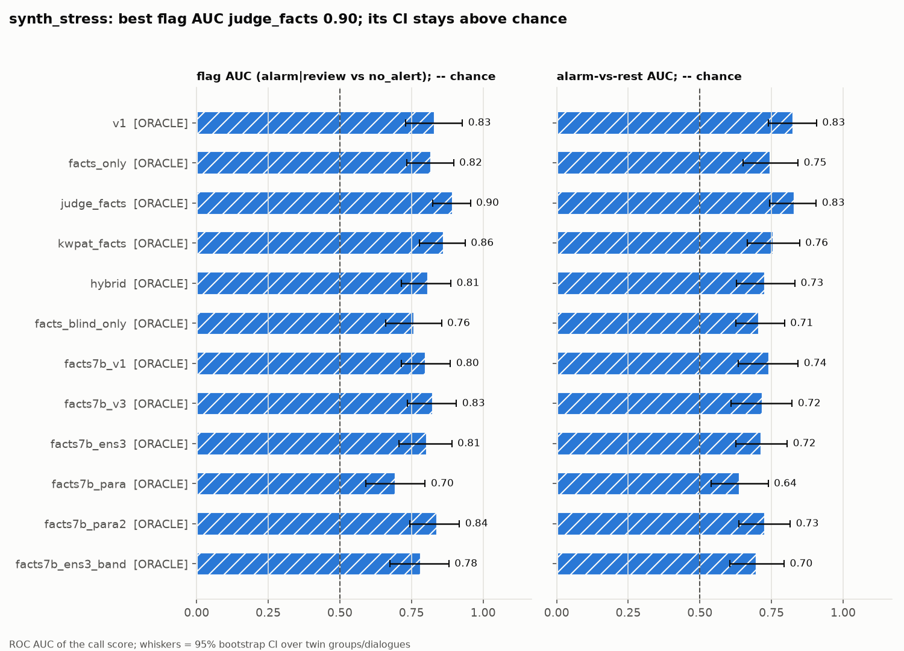

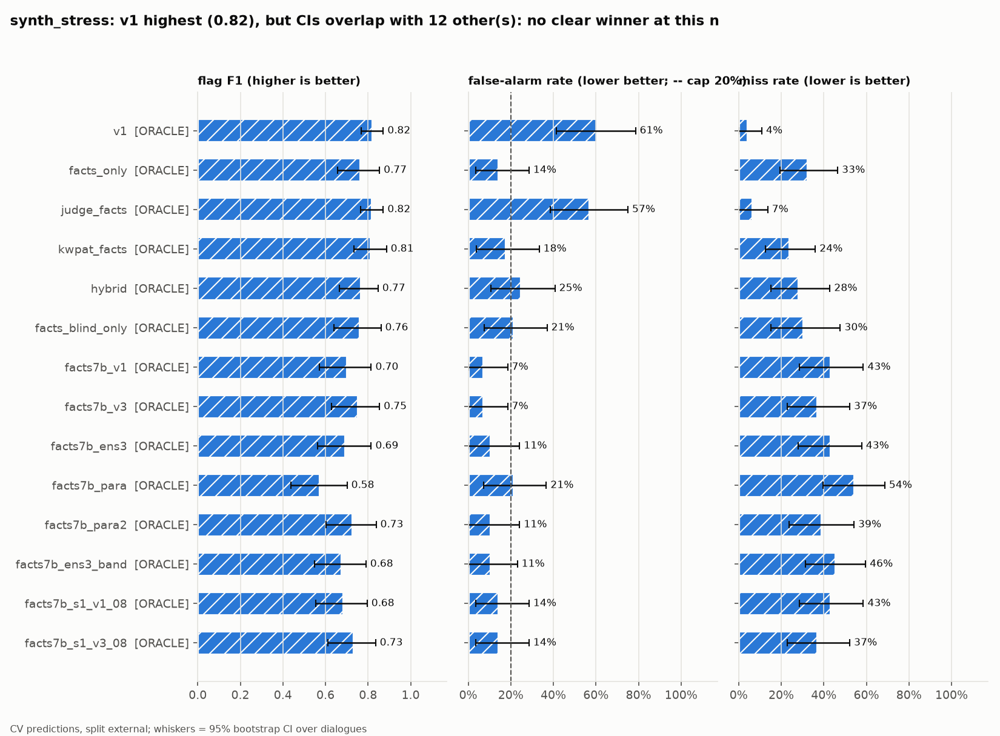

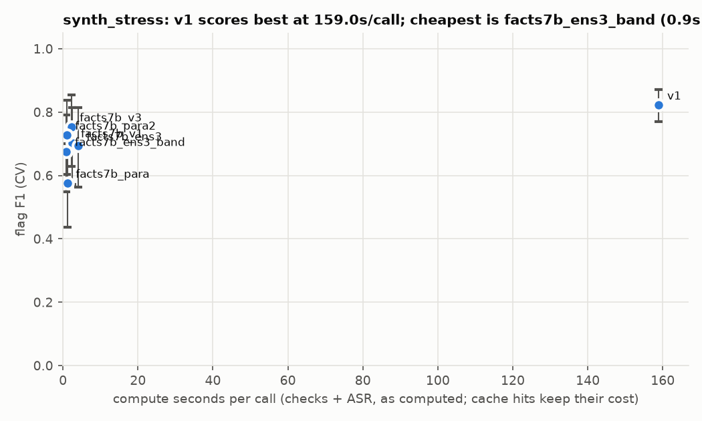

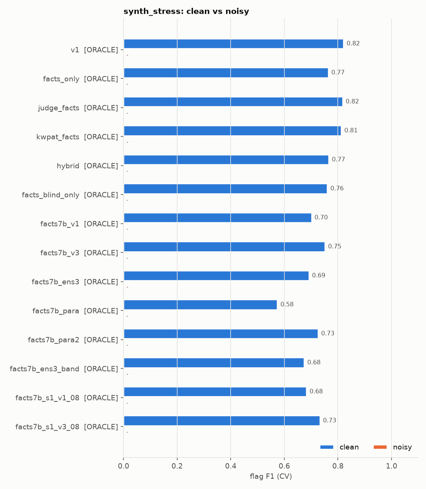

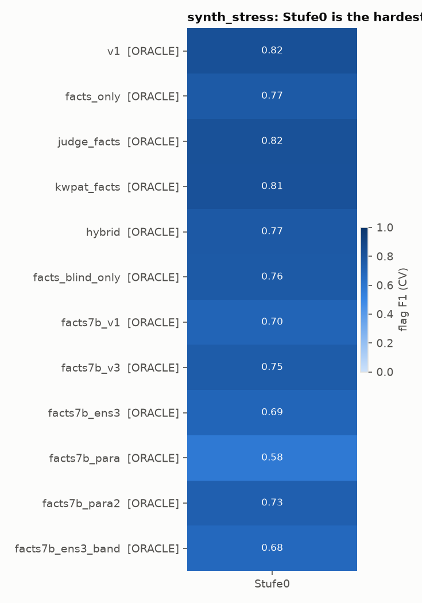

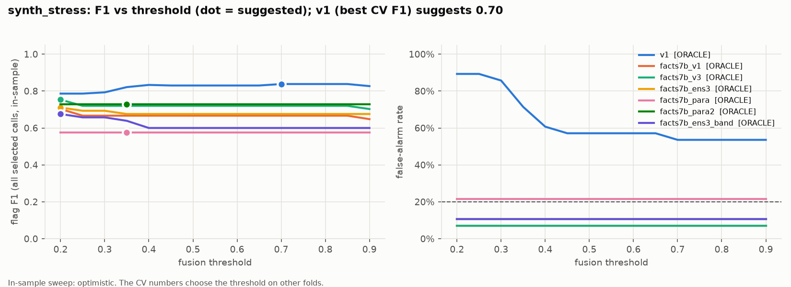

- `facts_only` vs `v1`: flag AUC -0.01 [-0.13, +0.10]; flag F1 -0.06 [-0.17, +0.04] (no detectable difference); FAR -46pp; McNemar p=1.0; 42 calls flip
- `judge_facts` vs `v1`: flag AUC +0.06 [-0.00, +0.13]; flag F1 -0.00 [-0.05, +0.03] (no detectable difference); FAR -4pp; McNemar p=1.0; 26 calls flip
- `kwpat_facts` vs `v1`: flag AUC +0.03 [-0.06, +0.12]; flag F1 -0.01 [-0.10, +0.07] (no detectable difference); FAR -43pp; McNemar p=0.7011; 47 calls flip
- `hybrid` vs `v1`: flag AUC -0.02 [-0.15, +0.09]; flag F1 -0.06 [-0.18, +0.04] (no detectable difference); FAR -36pp; McNemar p=1.0; 43 calls flip
- `facts_blind_only` vs `v1`: flag AUC -0.07 [-0.20, +0.05]; flag F1 -0.06 [-0.19, +0.05] (no detectable difference); FAR -39pp; McNemar p=1.0; 42 calls flip
- `facts7b_v1` vs `v1`: flag AUC -0.03 [-0.16, +0.10]; flag F1 -0.12 [-0.26, +0.00] (no detectable difference); FAR -54pp; McNemar p=0.7428; 46 calls flip
- `facts7b_v3` vs `v1`: flag AUC -0.01 [-0.14, +0.13]; flag F1 -0.07 [-0.21, +0.05] (no detectable difference); FAR -54pp; McNemar p=1.0; 46 calls flip
- `facts7b_ens3` vs `v1`: flag AUC -0.03 [-0.16, +0.10]; flag F1 -0.13 [-0.26, -0.01] (**real difference**); FAR -50pp; McNemar p=0.6076; 45 calls flip
- `facts7b_para` vs `v1`: flag AUC -0.14 [-0.27, +0.01]; flag F1 -0.25 [-0.39, -0.11] (**real difference**); FAR -39pp; McNemar p=0.0807; 50 calls flip
- `facts7b_para2` vs `v1`: flag AUC +0.01 [-0.11, +0.13]; flag F1 -0.10 [-0.22, +0.02] (no detectable difference); FAR -50pp; McNemar p=0.8601; 43 calls flip
- `facts7b_ens3_band` vs `v1`: flag AUC -0.05 [-0.19, +0.10]; flag F1 -0.15 [-0.28, -0.02] (**real difference**); FAR -50pp; McNemar p=0.5114; 49 calls flip

## synth_stress_audited

AUDITED subset (data_synth/v1/audit.json, invalid + doubtful scripts removed) of the synthetic stress test (ORACLE text) - v1 checks vs facts vs judge+facts

RQ: RQ5, RQ10 · split external · baseline `v1` · details: `runs/experiments/synth_stress_audited/summary.md`

Floor on these calls: flag-all flag F1 0.76 (FAR 100%), flag-none 0.00, constant score AUC 0.50.

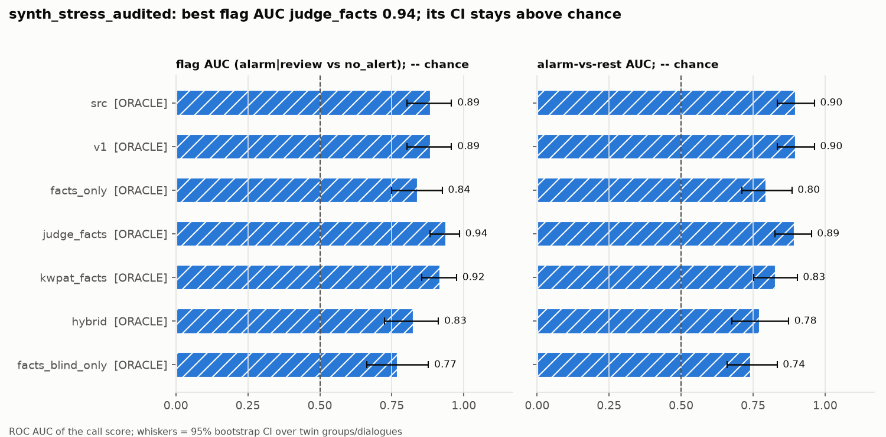

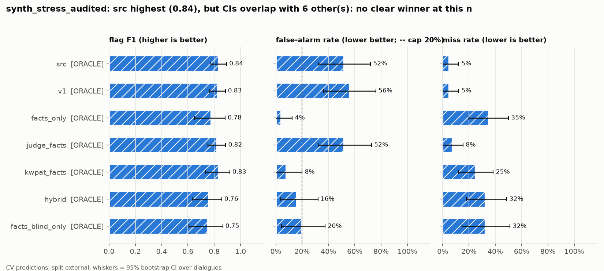

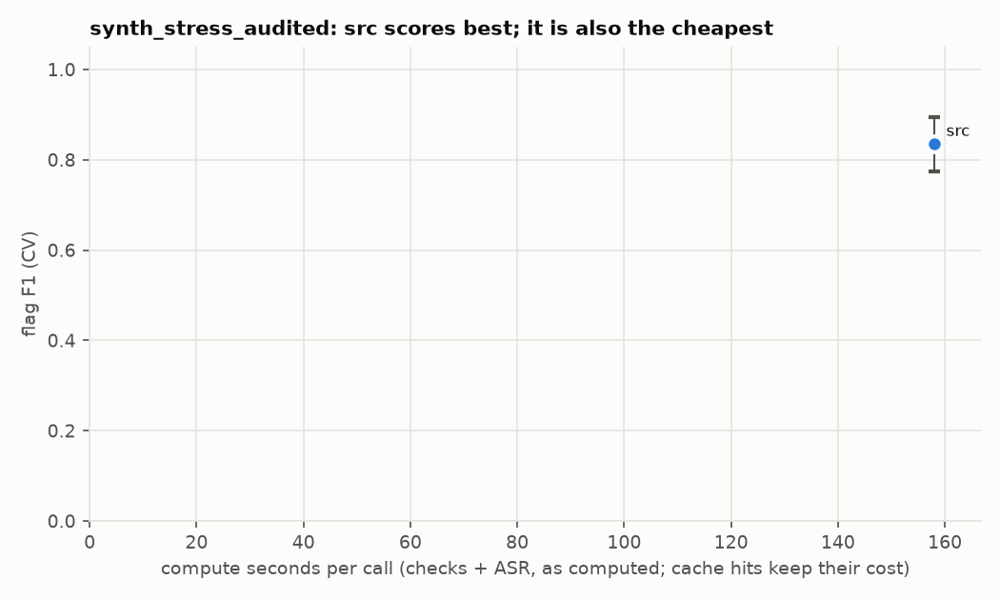

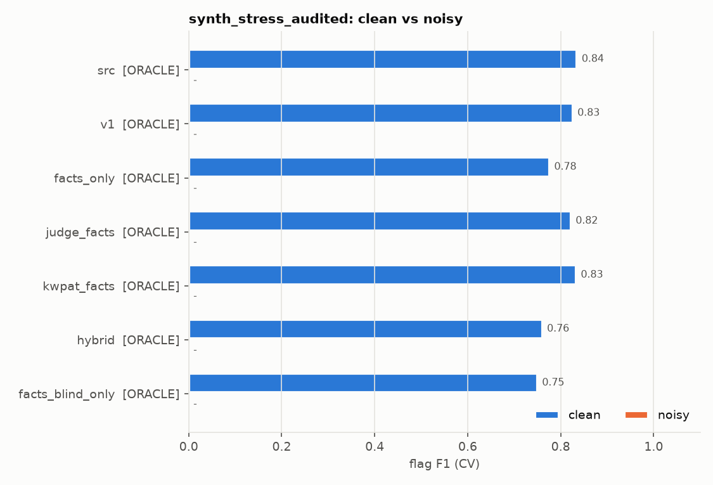

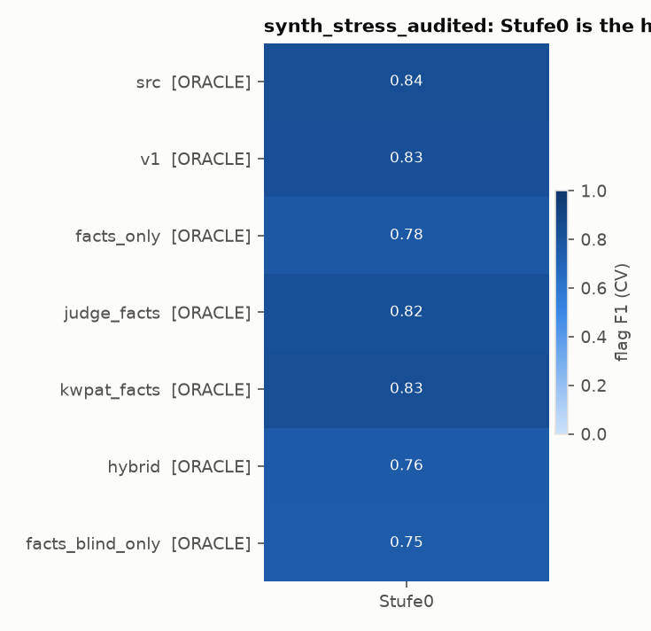

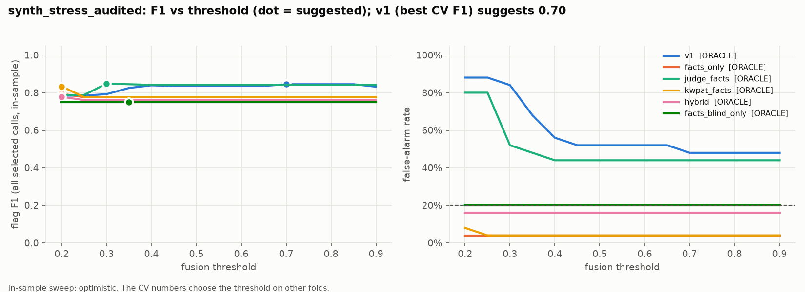

- `src` vs `v1`: flag AUC +0.00 [+0.00, +0.00]; flag F1 +0.00 [+0.00, +0.00] (no detectable difference); FAR +0pp; McNemar p=1.0; 0 calls flip
- `facts_only` vs `v1`: flag AUC -0.04 [-0.16, +0.07]; flag F1 -0.05 [-0.19, +0.07] (no detectable difference); FAR -52pp; McNemar p=1.0; 39 calls flip
- `judge_facts` vs `v1`: flag AUC +0.06 [-0.01, +0.13]; flag F1 -0.00 [-0.06, +0.04] (no detectable difference); FAR -4pp; McNemar p=1.0; 22 calls flip
- `kwpat_facts` vs `v1`: flag AUC +0.03 [-0.06, +0.13]; flag F1 +0.01 [-0.10, +0.11] (no detectable difference); FAR -48pp; McNemar p=0.5572; 41 calls flip
- `hybrid` vs `v1`: flag AUC -0.06 [-0.19, +0.06]; flag F1 -0.07 [-0.21, +0.05] (no detectable difference); FAR -40pp; McNemar p=1.0; 41 calls flip
- `facts_blind_only` vs `v1`: flag AUC -0.11 [-0.24, +0.01]; flag F1 -0.08 [-0.23, +0.06] (no detectable difference); FAR -36pp; McNemar p=0.845; 38 calls flip

