# callguard research report

Generated 2026-10-10 01:53 by `callguard report` from 4 experiment(s). Primary numbers are out-of-fold (CV) on the dev split; whiskers and brackets are 95% bootstrap CIs over dialogues (clean+noisy resampled together). With ~24 dev dialogues, differences inside the CIs are noise.

## Top variants

| # | experiment / variant | split | n | flag AUC [95% CI] | alarm AUC | CV@FAR20 F1 / R / FAR | CV flag F1 [95% CI] | FAR | miss | bal. acc | review recall | alarm F1 | acc | check s/call | LLM calls/call | commit | tags |
|---|---|---|---|---|---|---|---|---|---|---|---|---|---|---|---|---|---|
| 1 | checks_ablation / **all_minus_keywords** | dev | 48 | 0.69 [0.55, 0.84] | 0.78 | 0.46 / 35% / 18% | 0.69 [0.54, 0.81] | 73% (!) | 15% | 0.56 | 33% | 0.64 | 46% | 31.8 | 10.0 | e1954e9ab6* | re-fusion of all |
| 2 | fusion / **unc025** | dev | 48 | 0.68 [0.54, 0.83] | 0.77 | 0.69 / 96% / 95% (!) | 0.69 [0.55, 0.82] | 95% (!) | 4% | 0.50 | 100% | 0.33 | 23% | 31.8 | 10.0 | e1954e9ab6* | re-fusion of base |
| 3 | fusion / **band020** | dev | 48 | 0.68 [0.54, 0.83] | 0.77 | 0.69 / 69% / 36% (!) | 0.69 [0.52, 0.82] | 73% (!) | 15% | 0.56 | 67% | 0.65 | 46% | 31.8 | 10.0 | e1954e9ab6* | re-fusion of base |
| 4 | asr_models / **turbo_gsw_int8** | dev | 48 | 0.68 [0.54, 0.83] | 0.77 | 0.67 / 65% / 36% (!) | 0.67 [0.46, 0.83] | 45% (!) | 31% | 0.62 | 67% | 0.55 | 50% | 31.8 | 10.0 | a72e6a6f84* |  |
| 5 | checks_ablation / **all** | dev | 48 | 0.68 [0.54, 0.83] | 0.77 | 0.67 / 65% / 36% (!) | 0.67 [0.46, 0.83] | 45% (!) | 31% | 0.62 | 67% | 0.55 | 50% | 31.8 | 10.0 | e1954e9ab6* |  |
| 6 | fusion / **base** | dev | 48 | 0.68 [0.54, 0.83] | 0.77 | 0.67 / 65% / 36% (!) | 0.67 [0.46, 0.83] | 45% (!) | 31% | 0.62 | 67% | 0.55 | 50% | 31.8 | 10.0 | a72e6a6f84* |  |
| 7 | fusion / **band010** | dev | 48 | 0.68 [0.54, 0.83] | 0.77 | 0.67 / 65% / 36% (!) | 0.67 [0.46, 0.83] | 45% (!) | 31% | 0.62 | 67% | 0.53 | 50% | 31.8 | 10.0 | e1954e9ab6* | re-fusion of base |
| 8 | fusion / **llmunc** | dev | 48 | 0.68 [0.54, 0.83] | 0.77 | 0.46 / 35% / 18% | 0.70 [0.54, 0.83] | 68% (!) | 15% | 0.58 | 33% | 0.67 | 50% | 31.8 | 10.0 | e1954e9ab6* | re-fusion of base |
| 9 | fusion / **unc045** | dev | 48 | 0.68 [0.54, 0.83] | 0.77 | 0.46 / 35% / 18% | 0.70 [0.54, 0.83] | 68% (!) | 15% | 0.58 | 33% | 0.67 | 50% | 31.8 | 10.0 | e1954e9ab6* | re-fusion of base |
| 10 | fusion / **noesc** | dev | 48 | 0.68 [0.54, 0.83] | 0.77 | 0.46 / 35% / 18% | 0.70 [0.54, 0.83] | 68% (!) | 15% | 0.58 | 33% | 0.67 | 50% | 31.8 | 10.0 | a72e6a6f84* | re-fusion of base |

`*` = uncommitted changes in the tree when the variant ran.

## asr_models

Detection quality per ASR model (Swiss German fine-tunes vs vanilla Whisper)

RQ: RQ2, RQ8 · split dev · baseline `turbo_gsw_int8` · details: `runs/experiments/asr_models/summary.md`

Floor on these calls: flag-all flag F1 0.70 (FAR 100%), flag-none 0.00, constant score AUC 0.50.

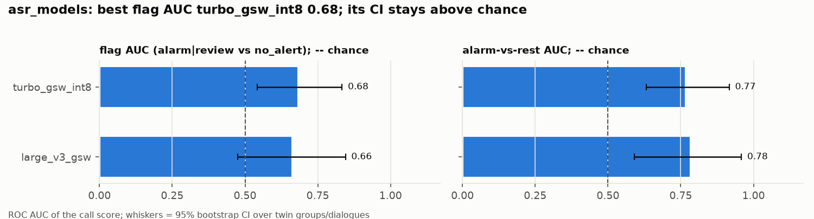

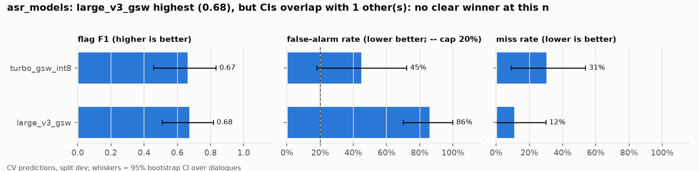

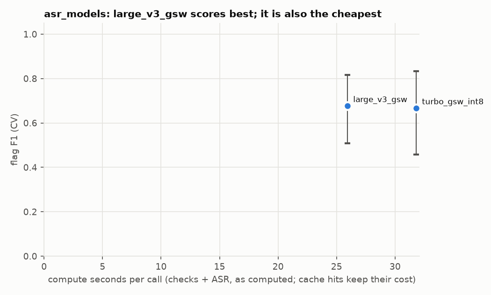

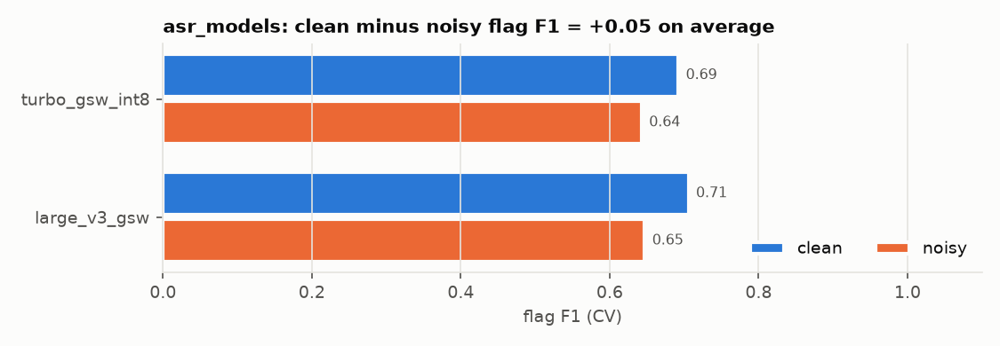

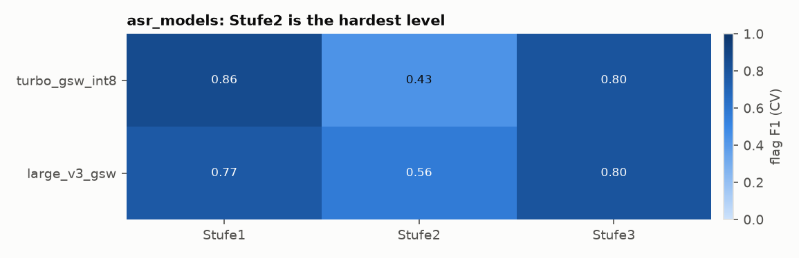

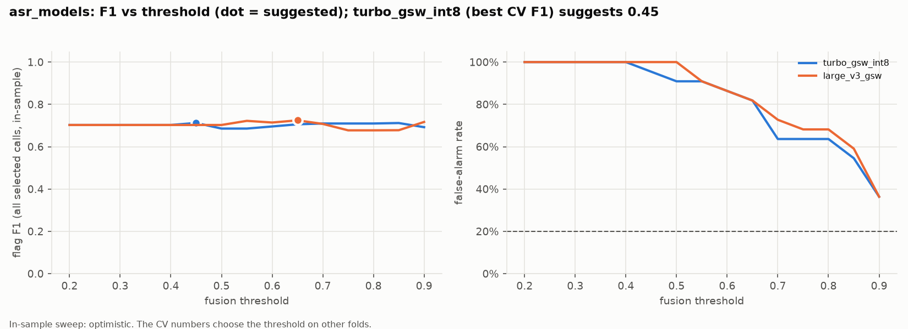

- `large_v3_gsw` vs `turbo_gsw_int8`: flag AUC -0.02 [-0.16, +0.11]; flag F1 +0.01 [-0.17, +0.18] (no detectable difference); FAR +41pp; McNemar p=0.5034; 28 calls flip

## checks_ablation

Which checks carry the decision (keywords, patterns, llm_judge, geval; add and remove)

RQ: RQ4 · split dev · baseline `all` · details: `runs/experiments/checks_ablation/summary.md`

Floor on these calls: flag-all flag F1 0.70 (FAR 100%), flag-none 0.00, constant score AUC 0.50.

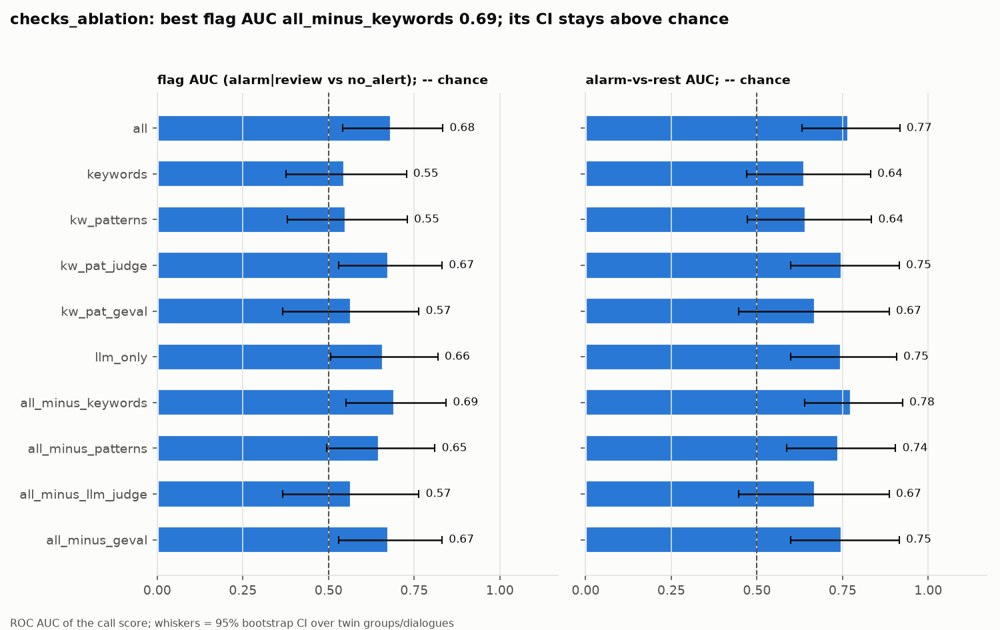

- `keywords` vs `all`: flag AUC -0.14 [-0.34, +0.04]; flag F1 -0.20 [-0.47, +0.02] (no detectable difference); FAR -14pp; McNemar p=0.4049; 25 calls flip
- `kw_patterns` vs `all`: flag AUC -0.13 [-0.33, +0.04]; flag F1 -0.30 [-0.59, -0.04] (**real difference**); FAR -23pp; McNemar p=0.3075; 26 calls flip
- `kw_pat_judge` vs `all`: flag AUC -0.01 [-0.05, +0.04]; flag F1 +0.02 [-0.11, +0.16] (no detectable difference); FAR +45pp; McNemar p=0.4545; 19 calls flip
- `kw_pat_geval` vs `all`: flag AUC -0.12 [-0.29, +0.05]; flag F1 -0.30 [-0.55, -0.06] (**real difference**); FAR -41pp; McNemar p=0.6636; 23 calls flip
- `llm_only` vs `all`: flag AUC -0.02 [-0.09, +0.02]; flag F1 +0.03 [-0.06, +0.14] (no detectable difference); FAR +23pp; McNemar p=1.0; 17 calls flip
- `all_minus_keywords` vs `all`: flag AUC +0.01 [-0.00, +0.03]; flag F1 +0.02 [-0.10, +0.15] (no detectable difference); FAR +27pp; McNemar p=0.7744; 19 calls flip
- `all_minus_patterns` vs `all`: flag AUC -0.04 [-0.11, +0.01]; flag F1 -0.01 [-0.16, +0.13] (no detectable difference); FAR +23pp; McNemar p=0.5488; 11 calls flip
- `all_minus_llm_judge` vs `all`: flag AUC -0.12 [-0.29, +0.05]; flag F1 -0.30 [-0.55, -0.06] (**real difference**); FAR -41pp; McNemar p=0.6636; 23 calls flip
- `all_minus_geval` vs `all`: flag AUC -0.01 [-0.05, +0.04]; flag F1 +0.02 [-0.11, +0.16] (no detectable difference); FAR +45pp; McNemar p=0.4545; 19 calls flip

## fusion

Weighted-fusion knobs (N14 abstention, uncertainty source, review band, uncertainty cap) as re-fusions of one check run; fitted fusions via `callguard fusion-cv`

RQ: RQ9, RQ4 · split dev · baseline `base` · details: `runs/experiments/fusion/summary.md`

Floor on these calls: flag-all flag F1 0.70 (FAR 100%), flag-none 0.00, constant score AUC 0.50.

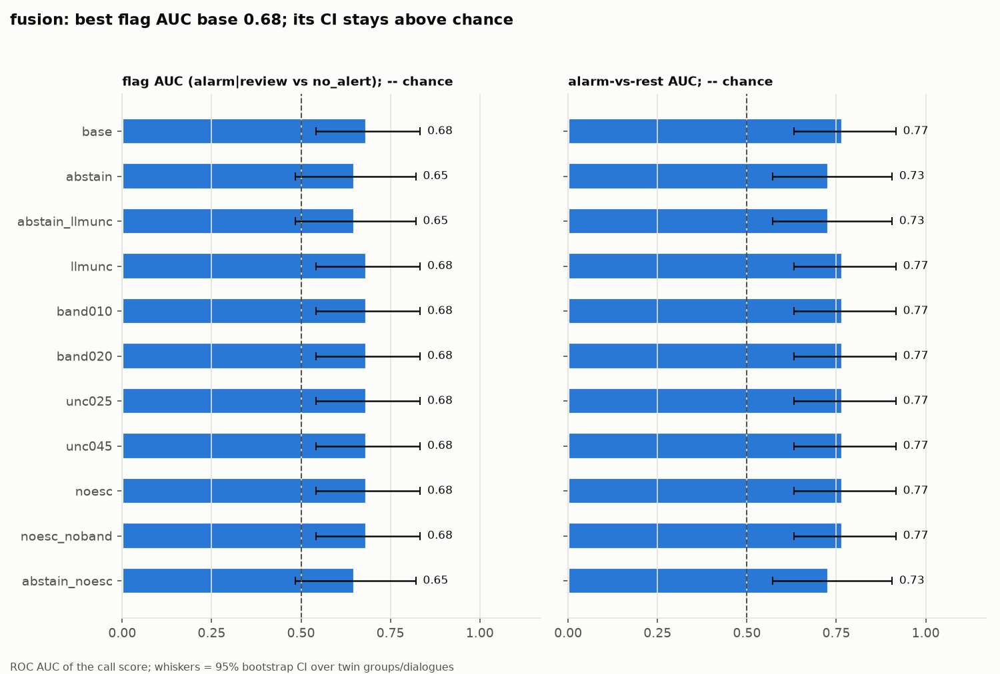

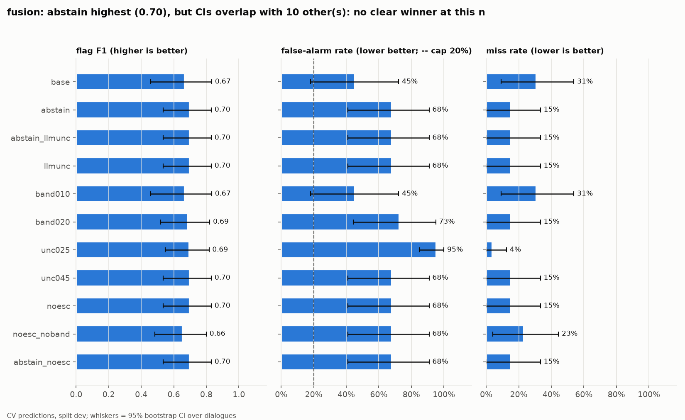

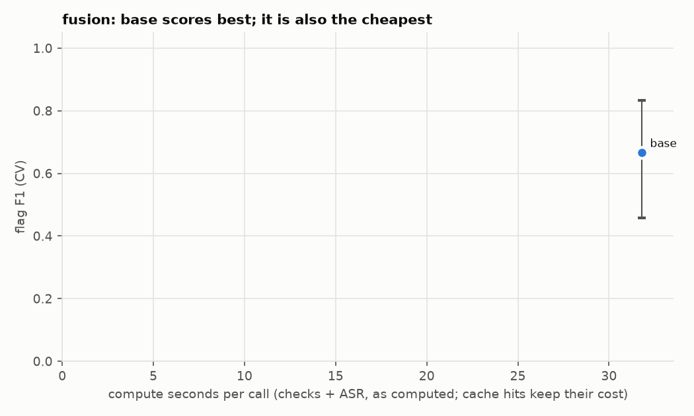

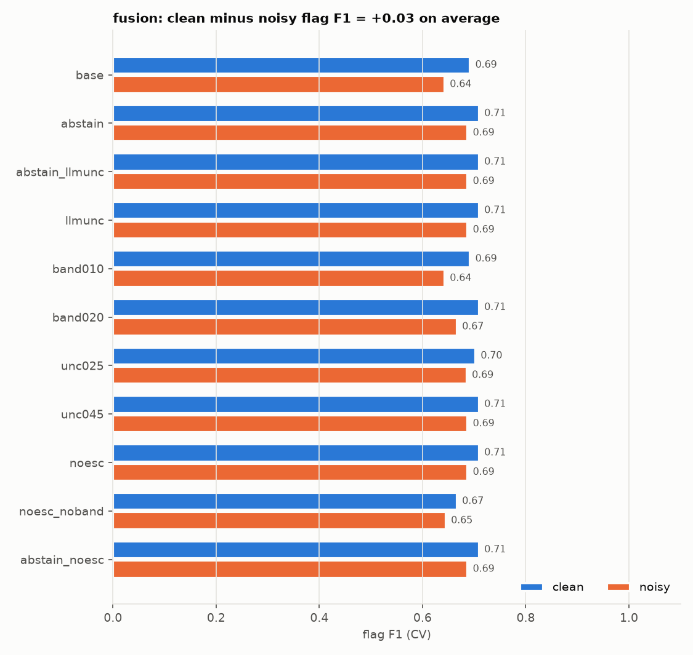

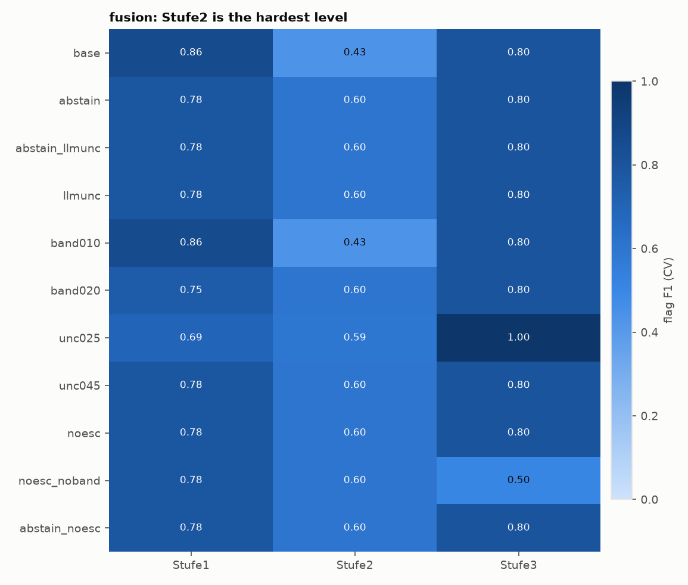

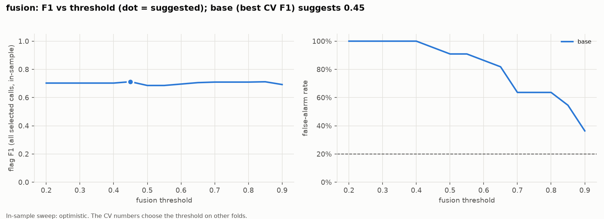

- `abstain` vs `base`: flag AUC -0.03 [-0.12, +0.04]; flag F1 +0.03 [-0.06, +0.14] (no detectable difference); FAR +23pp; McNemar p=1.0; 16 calls flip
- `abstain_llmunc` vs `base`: flag AUC -0.03 [-0.12, +0.04]; flag F1 +0.03 [-0.06, +0.14] (no detectable difference); FAR +23pp; McNemar p=1.0; 16 calls flip
- `llmunc` vs `base`: flag AUC +0.00 [+0.00, +0.00]; flag F1 +0.03 [-0.06, +0.14] (no detectable difference); FAR +23pp; McNemar p=1.0; 16 calls flip
- `band010` vs `base`: flag AUC +0.00 [+0.00, +0.00]; flag F1 +0.00 [+0.00, +0.00] (no detectable difference); FAR +0pp; McNemar p=1.0; 1 calls flip
- `band020` vs `base`: flag AUC +0.00 [+0.00, +0.00]; flag F1 +0.02 [-0.07, +0.14] (no detectable difference); FAR +27pp; McNemar p=0.7539; 11 calls flip
- `unc025` vs `base`: flag AUC +0.00 [+0.00, +0.00]; flag F1 +0.03 [-0.10, +0.18] (no detectable difference); FAR +50pp; McNemar p=0.4807; 23 calls flip
- `unc045` vs `base`: flag AUC +0.00 [+0.00, +0.00]; flag F1 +0.03 [-0.06, +0.14] (no detectable difference); FAR +23pp; McNemar p=1.0; 16 calls flip
- `noesc` vs `base`: flag AUC +0.00 [+0.00, +0.00]; flag F1 +0.03 [-0.06, +0.14] (no detectable difference); FAR +23pp; McNemar p=1.0; 16 calls flip
- `noesc_noband` vs `base`: flag AUC +0.00 [+0.00, +0.00]; flag F1 -0.01 [-0.16, +0.13] (no detectable difference); FAR +23pp; McNemar p=0.5488; 25 calls flip
- `abstain_noesc` vs `base`: flag AUC -0.03 [-0.12, +0.04]; flag F1 +0.03 [-0.06, +0.14] (no detectable difference); FAR +23pp; McNemar p=1.0; 16 calls flip

## smoke

Plumbing check on demo-offline (reference scripts + fake LLM); numbers are meaningless.

RQ: - · split dev · baseline `all` · details: `runs/experiments/smoke/summary.md`

Floor on these calls: flag-all flag F1 0.70 (FAR 100%), flag-none 0.00, constant score AUC 0.50.

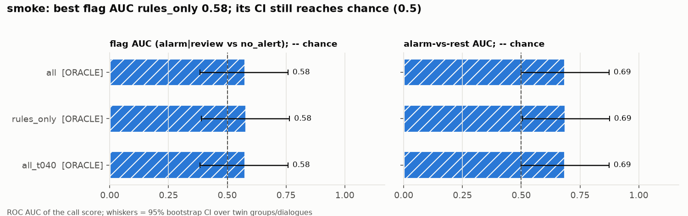

- `rules_only` vs `all`: flag AUC +0.00 [-0.02, +0.04]; flag F1 +0.05 [+0.00, +0.16] (no detectable difference); FAR +9pp; McNemar p=1.0; 12 calls flip
- `all_t040` vs `all`: flag AUC +0.00 [+0.00, +0.00]; flag F1 +0.00 [+0.00, +0.00] (no detectable difference); FAR +0pp; McNemar p=1.0; 0 calls flip

