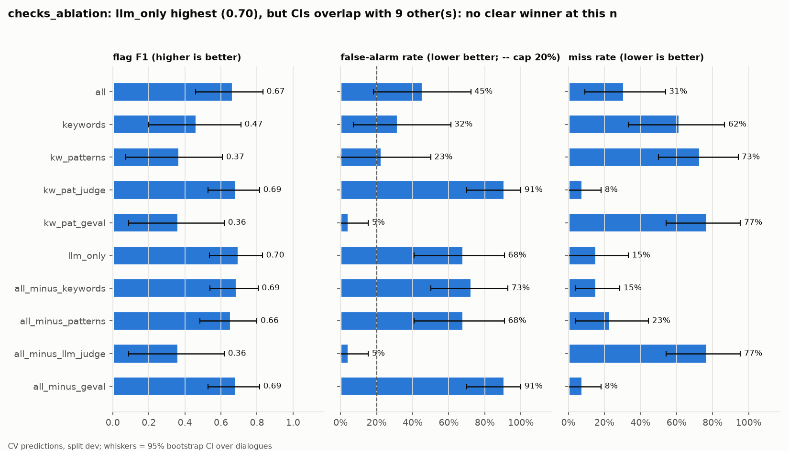
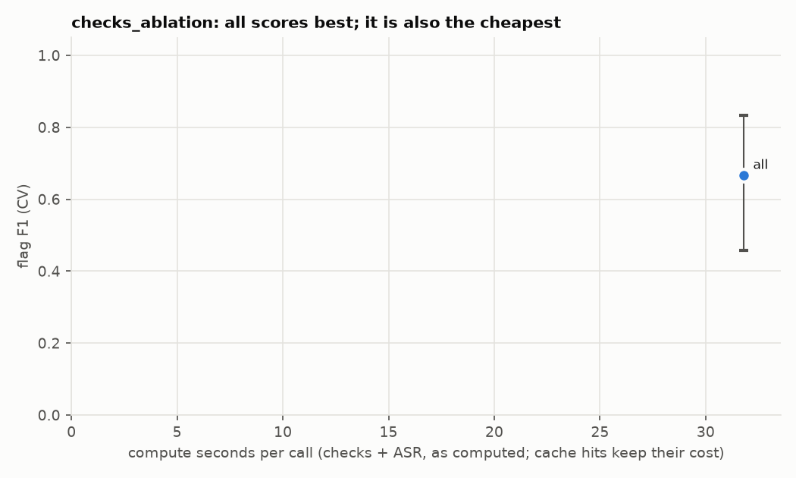
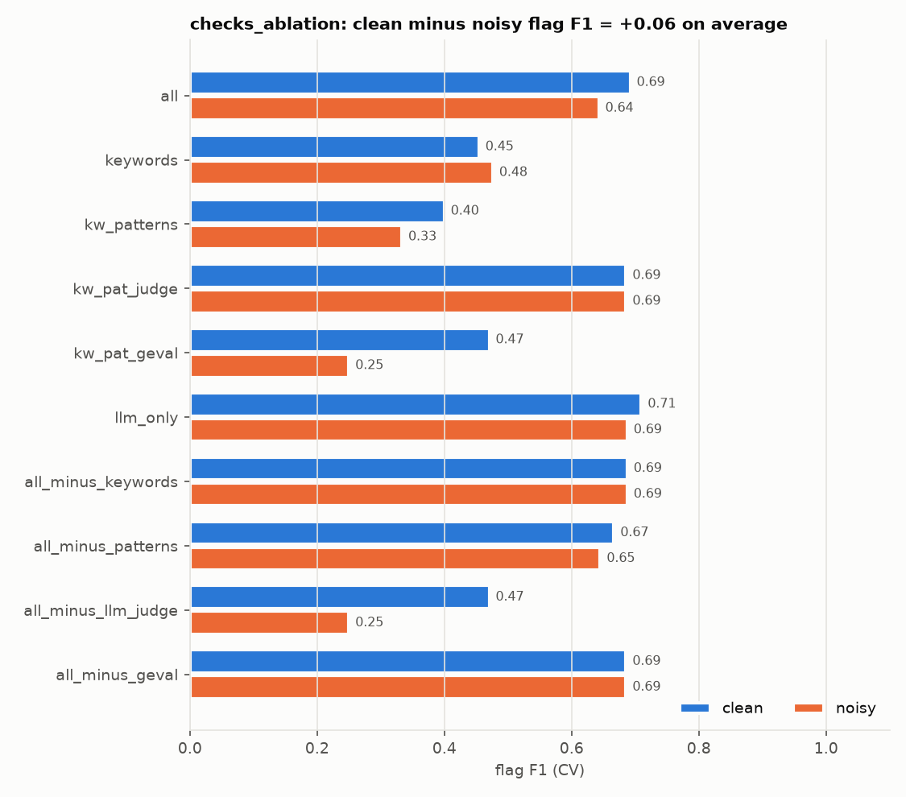
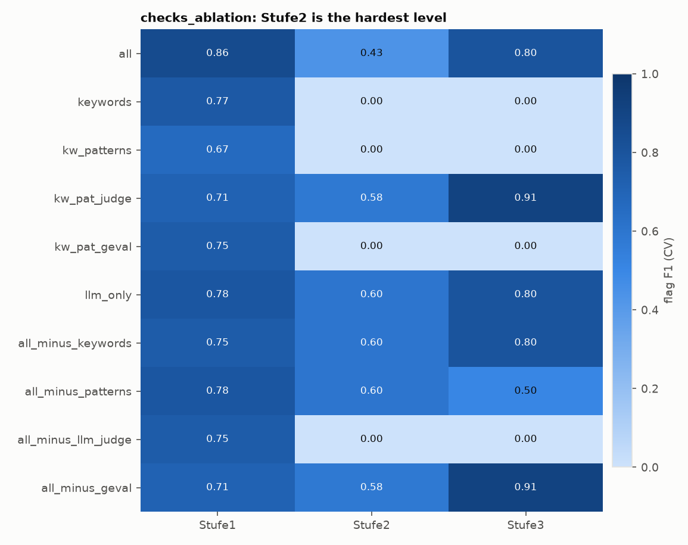
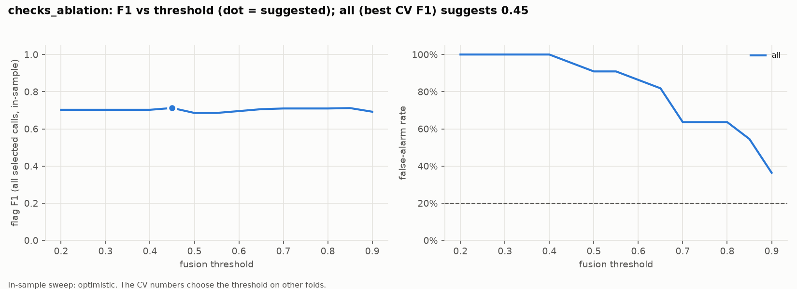
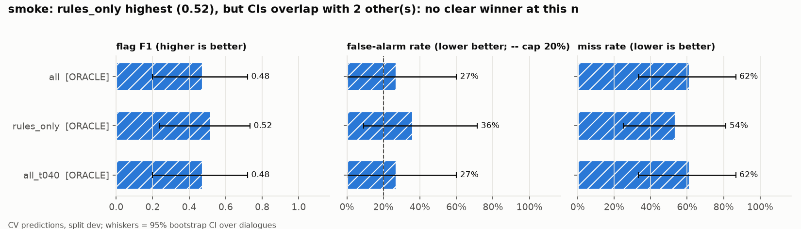
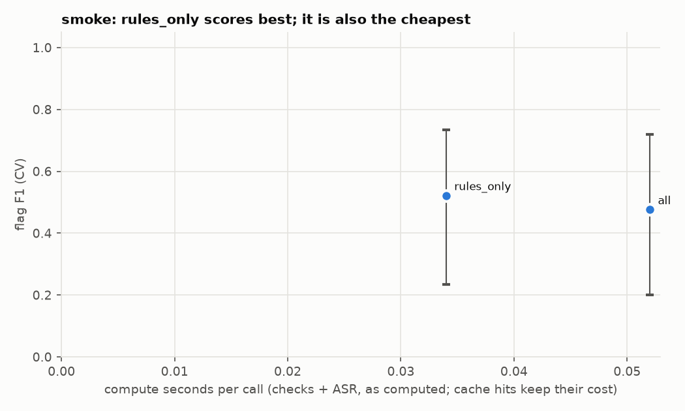
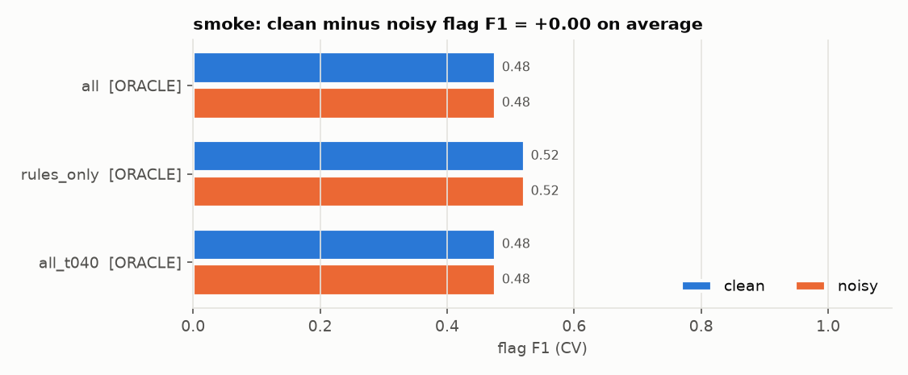
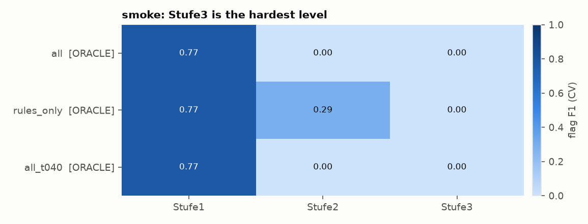
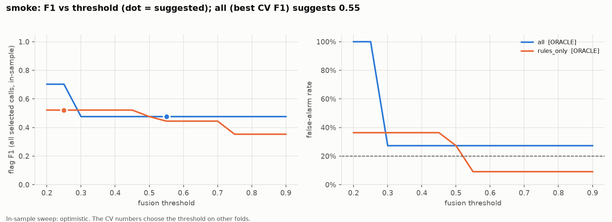

# callguard research report

Generated 2026-10-10 01:46 by `callguard report` from 2 experiment(s). Primary numbers are out-of-fold (CV) on the dev split; whiskers and brackets are 95% bootstrap CIs over dialogues (clean+noisy resampled together). With ~24 dev dialogues, differences inside the CIs are noise.

## Top variants

| # | experiment / variant | split | n | CV flag F1 [95% CI] | FAR | miss | review recall | alarm F1 | acc | check s/call | LLM calls/call | commit | tags |
|---|---|---|---|---|---|---|---|---|---|---|---|---|---|
| 1 | checks_ablation / **llm_only** | dev | 48 | 0.70 [0.54, 0.83] | 68% (!) | 15% | 33% | 0.70 | 50% | 31.8 | 10.0 | e1954e9ab6* | re-fusion of all |
| 2 | checks_ablation / **all_minus_keywords** | dev | 48 | 0.69 [0.54, 0.81] | 73% (!) | 15% | 33% | 0.64 | 46% | 31.8 | 10.0 | e1954e9ab6* | re-fusion of all |
| 3 | checks_ablation / **kw_pat_judge** | dev | 48 | 0.69 [0.53, 0.81] | 91% (!) | 8% | 83% | 0.44 | 27% | 15.6 | 5.0 | e1954e9ab6* | re-fusion of all |
| 4 | checks_ablation / **all_minus_geval** | dev | 48 | 0.69 [0.53, 0.81] | 91% (!) | 8% | 83% | 0.44 | 27% | 15.6 | 5.0 | e1954e9ab6* | re-fusion of all |
| 5 | checks_ablation / **all** | dev | 48 | 0.67 [0.46, 0.83] | 45% (!) | 31% | 67% | 0.55 | 50% | 31.8 | 10.0 | e1954e9ab6* |  |
| 6 | checks_ablation / **all_minus_patterns** | dev | 48 | 0.66 [0.48, 0.80] | 68% (!) | 23% | 33% | 0.63 | 44% | 31.8 | 10.0 | e1954e9ab6* | re-fusion of all |
| 7 | smoke / **rules_only** | dev | 48 | 0.52 [0.24, 0.73] | 36% (!) | 54% | 0% | 0.53 | 50% | 0.0 | 0.0 | 8e00d1ef66* | ORACLE |
| 8 | smoke / **all** | dev | 48 | 0.48 [0.20, 0.72] | 27% (!) | 62% | 0% | 0.31 | 42% | 0.1 | 10.0 | 8e00d1ef66* | ORACLE |
| 9 | smoke / **all_t040** | dev | 48 | 0.48 [0.20, 0.72] | 27% (!) | 62% | 0% | 0.31 | 42% | 0.1 | 10.0 | 8e00d1ef66* | ORACLE, re-fusion of all |
| 10 | checks_ablation / **keywords** | dev | 48 | 0.47 [0.20, 0.71] | 32% (!) | 62% | 0% | 0.50 | 50% | 0.0 | 0.0 | e1954e9ab6* | re-fusion of all |

`*` = uncommitted changes in the tree when the variant ran.

## checks_ablation

Which checks carry the decision (keywords, patterns, llm_judge, geval; add and remove)

RQ: RQ4 · split dev · baseline `all` · details: `runs/experiments/checks_ablation/summary.md`

- `keywords` vs `all`: flag F1 -0.20 [-0.47, +0.02] (no detectable difference); FAR -14pp; McNemar p=0.4049; 25 calls flip
- `kw_patterns` vs `all`: flag F1 -0.30 [-0.59, -0.04] (**real difference**); FAR -23pp; McNemar p=0.3075; 26 calls flip
- `kw_pat_judge` vs `all`: flag F1 +0.02 [-0.11, +0.16] (no detectable difference); FAR +45pp; McNemar p=0.4545; 19 calls flip
- `kw_pat_geval` vs `all`: flag F1 -0.30 [-0.55, -0.06] (**real difference**); FAR -41pp; McNemar p=0.6636; 23 calls flip
- `llm_only` vs `all`: flag F1 +0.03 [-0.06, +0.14] (no detectable difference); FAR +23pp; McNemar p=1.0; 17 calls flip
- `all_minus_keywords` vs `all`: flag F1 +0.02 [-0.10, +0.15] (no detectable difference); FAR +27pp; McNemar p=0.7744; 19 calls flip
- `all_minus_patterns` vs `all`: flag F1 -0.01 [-0.16, +0.13] (no detectable difference); FAR +23pp; McNemar p=0.5488; 11 calls flip
- `all_minus_llm_judge` vs `all`: flag F1 -0.30 [-0.55, -0.06] (**real difference**); FAR -41pp; McNemar p=0.6636; 23 calls flip
- `all_minus_geval` vs `all`: flag F1 +0.02 [-0.11, +0.16] (no detectable difference); FAR +45pp; McNemar p=0.4545; 19 calls flip

## smoke

Plumbing check on demo-offline (reference scripts + fake LLM); numbers are meaningless.

RQ: - · split dev · baseline `all` · details: `runs/experiments/smoke/summary.md`

- `rules_only` vs `all`: flag F1 +0.05 [+0.00, +0.16] (no detectable difference); FAR +9pp; McNemar p=1.0; 12 calls flip
- `all_t040` vs `all`: flag F1 +0.00 [+0.00, +0.00] (no detectable difference); FAR +0pp; McNemar p=1.0; 0 calls flip

